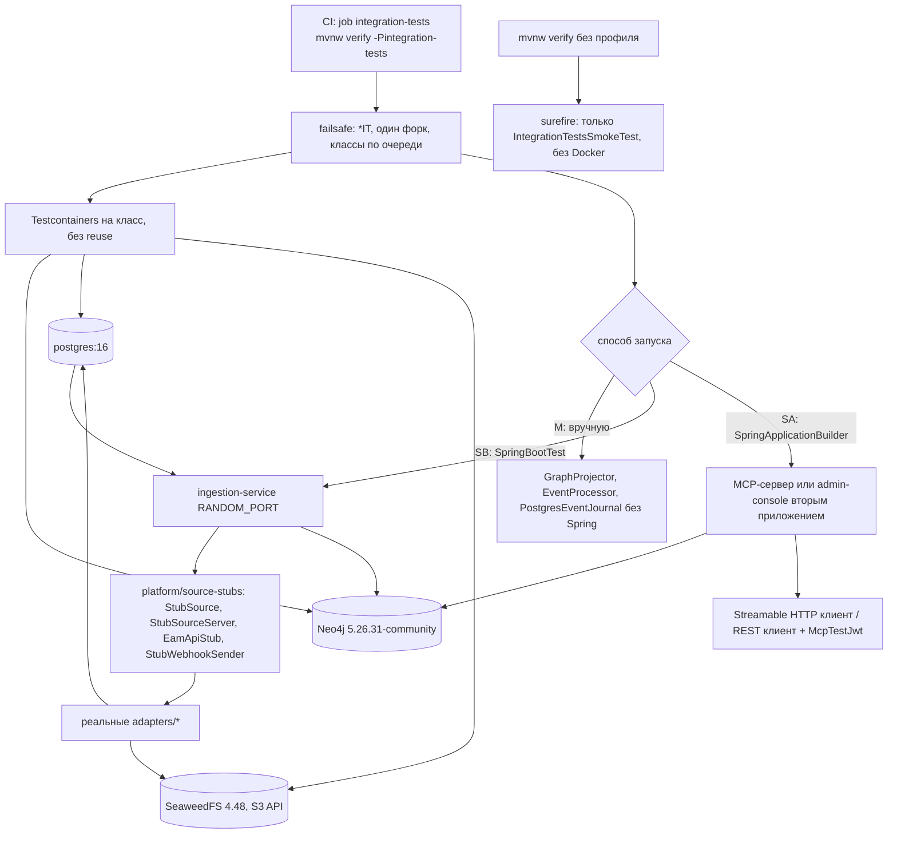

# platform/integration-tests: требования

> Тестовый модуль сквозной приёмки: прогоняет код всех остальных групп на настоящих Neo4j Community, PostgreSQL и S3-совместимом хранилище. Пути развёрнуты до корня репозитория. Дизайн: [`design.md`](design.md); контракты (образы, свойства, claims, фикстуры): [`contracts.md`](contracts.md); открытые вопросы: [`questions.md`](questions.md); решения: [`decisions.md`](decisions.md); задачи: [`tasks.md`](tasks.md).
> Use case-спецификации: [`acceptance-mcp-f1-f4/`](acceptance-mcp-f1-f4/requirements.md), [`sync-reconcile/`](sync-reconcile/requirements.md), [`projection-identity-conflicts/`](projection-identity-conflicts/requirements.md), [`query-core-read/`](query-core-read/requirements.md), [`admin-console-security/`](admin-console-security/requirements.md).
> Входные материалы: [`../flowcharts/integration-tests.md`](../flowcharts/integration-tests.md), [`../code-analysis.md`](../code-analysis.md) §Z1, [`../data-dictionary.md`](../data-dictionary.md) §Z.1, [`../detective-gaps.md`](../detective-gaps.md), [`../traceability/spec-impact-matrix.md`](../traceability/spec-impact-matrix.md), [`../tech-debt.md`](../tech-debt.md).

## Визуальная схема



## Visão Geral

`platform/integration-tests` — единственный модуль, который доказывает сквозные свойства PoC: адаптеры (на заглушках) → журнал `inbox_event` + S3 raw → диспетчер, нормализатор, identity, проектор → Neo4j → MCP-tools и консоль. В `src/main` лежит только маркер `IntegrationTestsModule` с `package-info`; вся работа — в `src/test`: 31 класс `*IT` (298 `@Test`), один unit-класс `IntegrationTestsSmokeTest` (1 `@Test`, выполняется surefire) и 6 вспомогательных классов (около 10,7 тыс. строк в `src/test`) 🟢 (`platform/integration-tests/src/main/java/io/github/unlocker/archrag/integrationtests/IntegrationTestsModule.java:3-7`; `platform/integration-tests/src/test/java/io/github/unlocker/archrag/integrationtests/IntegrationTestsSmokeTest.java:7-13`). Тесты не содержат прод-логики. Покрывают критерии готовности PoC 1–7 и 9 (`docs/00-vision.md:798-807`) и ловушки 1–6, 9, 10, 13, 14 профиля агента; критерий 8 (backup/restore) и ловушки 7, 8 не покрыты (🟢 [R.8: ответ владельца, вопрос 14] Q-02, Q-03).

## Responsabilidades

- Поднимать контейнеры Neo4j Community, PostgreSQL и S3 (SeaweedFS) на точных тегах образов и применять схему тем же кодом, что в проде (`Neo4jSchema.apply`, `JournalMigrations.apply`) 🟢.
- Собирать тестируемый конвейер тремя способами: вручную (без Spring), как `@SpringBootTest` ingestion-сервиса, как второе приложение через `SpringApplicationBuilder` (MCP или консоль) 🟢.
- Давать реальную цепочку JWT для MCP, консоли и admin REST (`McpTestJwt`: RSA + JWKS) и проверять отказы 401/403 там, где они покрыты 🟢.
- Запускаться только под профилем `integration-tests`; обычный `verify` не требует Docker 🟢 (`platform/integration-tests/pom.xml:136-157`).
- Фиксировать негативные сценарии идемпотентности, версий, неполных записей, удаления только после полного snapshot, лимитов запросов и read-only доступа 🟢.

## Regras de Negócio

- Образы: Neo4j `neo4j:5.26.31-community` (точный тег), PostgreSQL `postgres:16` (плавающий в пределах мажора), S3 `chrislusf/seaweedfs:4.48` 🟢 (`platform/integration-tests/src/test/java/io/github/unlocker/archrag/integrationtests/TestImages.java:9`; `platform/integration-tests/src/test/java/io/github/unlocker/archrag/integrationtests/ContainersSmokeIT.java:35, 41`).
- Контейнеры принадлежат классу, создаются заново на каждый класс, `withReuse` не используется; ≈ 60 запусков за прогон (26 Neo4j + 23 PostgreSQL + 11 S3) 🟢 (подсчёт по `grep` в `platform/integration-tests/src/test/java/io/github/unlocker/archrag/integrationtests/`).
- Схема не дублируется в тестах: Neo4j — `Neo4jSchema.apply(driver)`, PostgreSQL — `JournalMigrations.apply(dataSource)` (миграции V1–V7 из трёх модулей через classpath), приложения вызывают их сами 🟢 (`platform/integration-tests/src/test/java/io/github/unlocker/archrag/integrationtests/GraphProjectorIT.java:88-100`; `platform/integration-tests/src/test/java/io/github/unlocker/archrag/integrationtests/Neo4jSchemaIT.java:30-35`).
- Классы `GraphQueryCoreIT` и `RuntimeFootprintIT` работают на «голой» базе без констрейнтов и индексов 🟡 (отсутствие вызова `Neo4jSchema.apply`).
- При `@TestInstance(PER_CLASS)` контекст Spring создаётся раньше расширения Testcontainers, поэтому контейнеры стартуют в `static {}` и останавливаются Ryuk 🟢 (`platform/integration-tests/src/test/java/io/github/unlocker/archrag/integrationtests/F1AcceptanceIT.java:91-97`).
- Ожидание асинхронности — собственный цикл `awaitTrue` (Awaitility в проект не входит): шаг 200 мс (100 мс в `JournalDispatcherIT`), таймаут 90 с (F1–F4, `EamKeyMigrationIT`), 60 с (`SyncAcceptanceIT`), 30 с (`JournalDispatcherIT`) 🟢 (`platform/integration-tests/src/test/java/io/github/unlocker/archrag/integrationtests/F1AcceptanceIT.java:84, 413-427`).
- Схемы JWT в IT три: настоящая проверка подписи по JWKS (`McpTestJwt`), подменённый `JwtDecoder` на HS256 (issuer/audience/`azp` не проверяются), без токенов 🟢; реальная цепочка ingestion (issuer + audience + `azp`) работает только в `AdminEndpointIT` 🟢 (`platform/integration-tests/src/test/java/io/github/unlocker/archrag/integrationtests/AdminEndpointIT.java:96-99`).
- Порядок методов `@Order` обязателен для F1–F4, `SyncAcceptanceIT`, `EamKeyMigrationIT`; одиночный запуск отдельного метода этих классов недопустим 🟢 (`platform/integration-tests/src/test/java/io/github/unlocker/archrag/integrationtests/SyncAcceptanceIT.java:84-85`).
- Секретов в Git нет: пароль читающей учётки Neo4j (литерал в `CREATE USER`, `platform/integration-tests/src/test/java/io/github/unlocker/archrag/integrationtests/F1AcceptanceIT.java:181`), пароль роли PostgreSQL (`SyncConsoleIT.RO_PASSWORD`, `platform/integration-tests/src/test/java/io/github/unlocker/archrag/integrationtests/SyncConsoleIT.java:42`), ключ HS256 (константа `KEY`), секреты webhook (константы `SECRET`), токен заглушки EAM API (`EamApiSupport.TOKEN`, `platform/integration-tests/src/test/java/io/github/unlocker/archrag/integrationtests/EamApiSupport.java:19`), ключи S3 (`ContainersSmokeIT.S3_ACCESS_KEY`, `S3_SECRET_KEY`) — тестовые литералы-константы 🟢; значения в спецификацию не переносятся.
- 🟡 [R.8: решение принято, реализация — UNLOCKER-276 (п. 11)] Несколько негативных проверок безопасности асимметричны (консоль, `crosswalks`, `reconcile`, MCP audience/exp) — Q-01.

## Таблица «IT-класс → проверяемое поведение → модули»

Обозначения: контейнеры N = Neo4j, P = PostgreSQL, S = S3; стиль M/SB/SA; (−) — есть негативные сценарии; № — ловушки профиля агента; К — критерии PoC `docs/00-vision.md:798-807` (критерий К — строка 797 + К).

| IT-класс (строка класса) | Проверяемое поведение | Модули под тестом | Кон. / стиль | № / К | Use case |
|--------------------------|----------------------|-------------------|--------------|-------|----------|
| `platform/integration-tests/src/test/java/io/github/unlocker/archrag/integrationtests/ContainersSmokeIT.java:27` (3) | Neo4j отвечает на Cypher, PG на `select 1`, S3 принимает и отдаёт объект; фабрика `s3Container()` общая для 11 классов | `ingestion/event-journal` (`S3RawPayloadStore`) | NPS / — | образы | [модуль](requirements.md) |
| `platform/integration-tests/src/test/java/io/github/unlocker/archrag/integrationtests/IntegrationTestsSmokeTest.java:7` (1) | маркер модуля на classpath (единственный тест surefire) | — | — / — | — | [модуль](requirements.md) |
| `platform/integration-tests/src/test/java/io/github/unlocker/archrag/integrationtests/Neo4jSchemaIT.java:23` (4) | двойной `apply` создаёт каждый constraint/индекс один раз; составной UNIQUE `SourceRecord(source,sourceType,sourceId)` отклоняет дубль; FULLTEXT `asset_text` (−) | `ingestion/graph-projector` (`Neo4jSchema`), `contracts/canonical-model` | N / M | 4 | [`projection-identity-conflicts`](projection-identity-conflicts/requirements.md) |
| `platform/integration-tests/src/test/java/io/github/unlocker/archrag/integrationtests/GraphProjectorIT.java:67` (51) | upsert/provenance, идемпотентность и версии, неполная запись, authority, темпоральные связи, tombstone, карантин, отложенные связи (−) | `ingestion/graph-projector`, `ingestion/event-journal`, `ingestion/identity-resolution`, `ingestion/normalizer`, `contracts/*` | NP / M | 4, 5, 6, 9, 10, 14; К3 | [`projection-identity-conflicts`](projection-identity-conflicts/requirements.md) |
| `platform/integration-tests/src/test/java/io/github/unlocker/archrag/integrationtests/EventJournalIT.java:35` (12) | pending keyset, дедупликация `source+eventId`, переходы и DLQ, checkpoint, raw по хешу, `JournalReader` (−) | `ingestion/event-journal`, `contracts/event-schemas` | PS / M | 6, 14 | [`projection-identity-conflicts`](projection-identity-conflicts/requirements.md) |
| `platform/integration-tests/src/test/java/io/github/unlocker/archrag/integrationtests/IdentityMappingIT.java:28` (9) | gid стабилен, crosswalk, гонки `resolve`/`approve` (−) | `ingestion/identity-resolution` | P / M | 4; ADR 0003, 0019 | [`projection-identity-conflicts`](projection-identity-conflicts/requirements.md) |
| `platform/integration-tests/src/test/java/io/github/unlocker/archrag/integrationtests/IdentityCandidateIT.java:47` (8) | кандидаты по hostname и по имени+владельцу, предел 50, replay (−) | `ingestion/identity-resolution`, `graph-projector`, `normalizer` | NP / M | ADR 0019 | [`projection-identity-conflicts`](projection-identity-conflicts/requirements.md) |
| `platform/integration-tests/src/test/java/io/github/unlocker/archrag/integrationtests/PostgresSourceConflictsIT.java:28` (12) | конфликты `PROPERTY` и `RELATION` в PG: открытие, закрытие, порядок прихода (−) | `ingestion/identity-resolution` | P / M | ADR 0008, 0030 | [`projection-identity-conflicts`](projection-identity-conflicts/requirements.md) |
| `platform/integration-tests/src/test/java/io/github/unlocker/archrag/integrationtests/SourceConflictIT.java:60` (7) | конфликт источников в графе: маркер только на ребре `ASSERTS` диссидента (−) | `graph-projector`, `identity-resolution`, `normalizer` | NP / M | ADR 0008 | [`projection-identity-conflicts`](projection-identity-conflicts/requirements.md) |
| `platform/integration-tests/src/test/java/io/github/unlocker/archrag/integrationtests/PlatformInvariantIT.java:47` (7) | инвариант платформы ИТ-системы (ADR 0031) (−) | `graph-projector`, `identity-resolution`, `normalizer` | NP / M | ADR 0031 | [`projection-identity-conflicts`](projection-identity-conflicts/requirements.md) |
| `platform/integration-tests/src/test/java/io/github/unlocker/archrag/integrationtests/DeployedFromIT.java:47` (11) | `DEPLOYED_FROM`, commit, конфликт системы развёртывания (−) | `graph-projector`, `normalizer`, `identity-resolution` | NP / M | 10, 14; ADR 0029, 0030 | [`projection-identity-conflicts`](projection-identity-conflicts/requirements.md) |
| `platform/integration-tests/src/test/java/io/github/unlocker/archrag/integrationtests/EamApiProjectionIT.java:46` (9) | срез `ITSystem → Solution → Platform` в любом порядке прихода (−) | `graph-projector`, `normalizer`, `identity-resolution` | NP / M | 4, 5, 6 | [`projection-identity-conflicts`](projection-identity-conflicts/requirements.md) |
| `platform/integration-tests/src/test/java/io/github/unlocker/archrag/integrationtests/GraphQueryCoreIT.java:35` (11) | шаблоны только для чтения, бюджеты, таймаут, глубина (−) | `access/graph-query-core` | N / M | 1, 2, 3 | [`query-core-read`](query-core-read/requirements.md) |
| `platform/integration-tests/src/test/java/io/github/unlocker/archrag/integrationtests/GetAssetIT.java:41` (6) | карточка актива и связи (−) | `graph-query-core`, `graph-projector` | N / M | 1 | [`query-core-read`](query-core-read/requirements.md) |
| `platform/integration-tests/src/test/java/io/github/unlocker/archrag/integrationtests/SearchAssetsIT.java:46` (13) | поиск: точное совпадение выше fulltext, фильтры, спецсимволы Lucene (−) | `graph-query-core`, `graph-projector` | N / M | 1 | [`query-core-read`](query-core-read/requirements.md) |
| `platform/integration-tests/src/test/java/io/github/unlocker/archrag/integrationtests/TraceDependenciesIT.java:41` (18) | trace/impact: цикл, глубина, фильтры, плотный граф (−) | `graph-query-core`, `graph-projector` | N / M | 2; К7 | [`query-core-read`](query-core-read/requirements.md) |
| `platform/integration-tests/src/test/java/io/github/unlocker/archrag/integrationtests/DeploymentCommitReadIT.java:35` (4) | чтение `DEPLOYED_FROM` в footprint/relations/trace | `graph-query-core`, `graph-projector` | N / M | 10 | [`query-core-read`](query-core-read/requirements.md) |
| `platform/integration-tests/src/test/java/io/github/unlocker/archrag/integrationtests/RuntimeFootprintIT.java:27` (9) | `find_runtime_footprint`: ряды, окружение, провенанс, исключения закрытых (−) | `graph-query-core` | N / M | 1; К9 | [`query-core-read`](query-core-read/requirements.md) |
| `platform/integration-tests/src/test/java/io/github/unlocker/archrag/integrationtests/ExplainProvenanceIT.java:63` (5) | `explain_provenance` как Java-метод: мастер, конфликт, tombstone (−) | `access/mcp-server` (tool), `graph-query-core`, `graph-projector` | NP / M | 9, 11 | [`query-core-read`](query-core-read/requirements.md) |
| `platform/integration-tests/src/test/java/io/github/unlocker/archrag/integrationtests/F1AcceptanceIT.java:79` (8) | F1: `search_assets`, `get_asset` по MCP Streamable HTTP, 401/403 (−) | `access/mcp-server`, `ingestion/*`, `adapters/*`, `platform/source-stubs` | NPS / SB+SA | 13; К1, К5 | [`acceptance-mcp-f1-f4`](acceptance-mcp-f1-f4/requirements.md) |
| `platform/integration-tests/src/test/java/io/github/unlocker/archrag/integrationtests/F2AcceptanceIT.java:83` (9) | F2: `find_runtime_footprint`, смена deploy map, замещённый хост (−) | то же | NPS / SB+SA | 13; К1, К5 | [`acceptance-mcp-f1-f4`](acceptance-mcp-f1-f4/requirements.md) |
| `platform/integration-tests/src/test/java/io/github/unlocker/archrag/integrationtests/F3AcceptanceIT.java:82` (8) | F3: `trace_dependencies` trace/impact, невалидный ввод, задержки (−) | то же | NPS / SB+SA | 2, 13; К5, К7, К9 | [`acceptance-mcp-f1-f4`](acceptance-mcp-f1-f4/requirements.md) |
| `platform/integration-tests/src/test/java/io/github/unlocker/archrag/integrationtests/F4AcceptanceIT.java:101` (7) | F4: `explain_provenance`, crosswalk, tombstone мастера (−) | то же + `ingestion/identity-resolution` | NPS / SB+SA | 9, 13; К5 | [`acceptance-mcp-f1-f4`](acceptance-mcp-f1-f4/requirements.md) |
| `platform/integration-tests/src/test/java/io/github/unlocker/archrag/integrationtests/AdapterInboxIT.java:40` (3) | webhook → `RECEIVED` + raw в S3; подпись/окно (−); маркер snapshot последним | `adapters/adapter-core`, `eam-adapter`, `ingestion/event-journal` | PS / M | 6, 9; К2 | [`sync-reconcile`](sync-reconcile/requirements.md) |
| `platform/integration-tests/src/test/java/io/github/unlocker/archrag/integrationtests/JournalDispatcherIT.java:63` (6) | фоновый диспетчер: карантин с кодом, маркер, неполный прогон (−) | `ingestion/ingestion-service`, `graph-projector`, `adapters/adapter-core` | NPS / SB | 9, 14 | [`sync-reconcile`](sync-reconcile/requirements.md) |
| `platform/integration-tests/src/test/java/io/github/unlocker/archrag/integrationtests/ReconciliationIT.java:65` (6) | удаление только после полного snapshot; сбой на середине (−) | `graph-projector` (`Reconciler`), `adapters/adapter-core` (`Poller`), `platform/source-stubs` | NP / M | 6, 9; К2 | [`sync-reconcile`](sync-reconcile/requirements.md) |
| `platform/integration-tests/src/test/java/io/github/unlocker/archrag/integrationtests/SyncAcceptanceIT.java:88` (11) | приёмка К1–К4: срез, p95 webhook, reconcile, повтор/перестановка, rebuild | `ingestion-service`, 4 адаптера, `platform/source-stubs` | NPS / SB | 6, 9; К1–К4 | [`sync-reconcile`](sync-reconcile/requirements.md) |
| `platform/integration-tests/src/test/java/io/github/unlocker/archrag/integrationtests/EamKeyMigrationIT.java:79` (5) | миграция ключа EAM `EAM-*` → целочисленный `id` | `ingestion-service`, `adapters/eam-adapter`, `adapters/scm-adapter` | NPS / SB | 9, 14 | [`sync-reconcile`](sync-reconcile/requirements.md) |
| `platform/integration-tests/src/test/java/io/github/unlocker/archrag/integrationtests/AdminEndpointIT.java:56` (13) | admin REST: rebuild, replay, crosswalks, reconcile, замок 409, JWT audience/`azp`/scope (−) | `ingestion/ingestion-service` | NPS / SB | 6, 9, 13; К3, К4 | [`admin-console-security`](admin-console-security/requirements.md) |
| `platform/integration-tests/src/test/java/io/github/unlocker/archrag/integrationtests/AdminConsoleIT.java:54` (8) | REST консоли графа: статистика, поиск, карточка, окрестность, read-only (−) | `access/admin-console`, `graph-query-core` | N / SA | 1, 2, 3 | [`admin-console-security`](admin-console-security/requirements.md) |
| `platform/integration-tests/src/test/java/io/github/unlocker/archrag/integrationtests/SyncConsoleIT.java:38` (14) | консоль журнала: роль `archrag_console_ro`, аудит чтений, фильтры, 401/403 (−) | `access/admin-console`, `ingestion/event-journal` | NP / SA | 3, 11, 13 | [`admin-console-security`](admin-console-security/requirements.md) |
| `platform/integration-tests/src/test/java/io/github/unlocker/archrag/integrationtests/IngestionMetricsIT.java:20` (1) | gauge `archrag.ingestion.sync.lag` и `dlq.open` по источнику | `ingestion/ingestion-service` (`IngestionMetrics`) | P / M | К9 | [`admin-console-security`](admin-console-security/requirements.md) |

Итог: 31 `*IT` + 1 unit-класс = 32 класса; 298 + 1 = 299 `@Test`; `@ParameterizedTest`, `@RepeatedTest`, `@TestFactory`, `@Disabled`, `@DisplayName` не используются 🟢.

## Requisitos Funcionais

| ID | Требование (что доказывает модуль) | Приоритет | Критерий приёмки |
|----|-----------------------------------|-----------|------------------|
| RF-01 | Среда поднимается на точных тегах, схема применяется кодом прода | Must | AC-01, AC-02 |
| RF-02 | Срез из четырёх источников загружается сквозь адаптеры, журнал, проектор (К1) | Must | [`sync-reconcile`](sync-reconcile/requirements.md) AC-01 |
| RF-03 | Webhook p95 ≤ 30 с, reconcile исправляет пропуск, повтор и перестановка не меняют граф, rebuild даёт эквивалентный граф (К2–К4) | Must | [`sync-reconcile`](sync-reconcile/requirements.md) AC-02..AC-05 |
| RF-04 | Пять MCP-tools по Streamable HTTP с 401/403 (К5) | Must | [`acceptance-mcp-f1-f4`](acceptance-mcp-f1-f4/requirements.md) AC-01..AC-06 |
| RF-05 | MCP и консоль не пишут: шаблоны проходят read-only проверку, сессия в режиме чтения (К6) | Must | [`query-core-read`](query-core-read/requirements.md) AC-01, AC-02 |
| RF-06 | Impact отдаёт объяснимые пути с провенансом и свежестью (К7) | Must | [`acceptance-mcp-f1-f4`](acceptance-mcp-f1-f4/requirements.md) AC-04 |
| RF-07 | Ловушки корректности 4, 5, 6, 9, 10, 14 проверяются негативными сценариями | Must | [`projection-identity-conflicts`](projection-identity-conflicts/requirements.md) AC-01..AC-08 |
| RF-08 | Admin REST и консоль: scope, audience, `azp`, замок и аудит | Must | [`admin-console-security`](admin-console-security/requirements.md) AC-01..AC-07 |
| RF-09 | Метрики лага и открытой DLQ из журнала | Should | [`admin-console-security`](admin-console-security/requirements.md) AC-08 |
| RF-10 | Миграция ключа EAM приводит к графу без дублей и без карантина | Should | [`sync-reconcile`](sync-reconcile/requirements.md) AC-06 |
| RF-11 | `verify` без профиля не требует Docker; профиль `integration-tests` включает failsafe; CI запускает оба независимо | Must | AC-03 |
| RF-12 | Backup/restore Neo4j и replay после восстановления (К8) | Won't | вне модуля, `platform/docker` (🟢 [R.8: ответ владельца, вопрос 14] Q-02) |

## Requisitos Não Funcionais

| Тип | Требование | Evidence | Уверенность |
|-----|------------|----------|-------------|
| Воспроизводимость | Точные теги Neo4j и S3; PostgreSQL — мажорный тег | `platform/integration-tests/src/test/java/io/github/unlocker/archrag/integrationtests/TestImages.java:5-9`; `platform/integration-tests/src/test/java/io/github/unlocker/archrag/integrationtests/ContainersSmokeIT.java:35, 41` | 🟢 (🟡 `postgres:16`) |
| Изоляция | Нет общего singleton-контейнера; очистка по классу: `MATCH (n) DETACH DELETE n`, `TRUNCATE`, либо уникальные UUID | `platform/integration-tests/src/test/java/io/github/unlocker/archrag/integrationtests/GraphProjectorIT.java:113-117`; `platform/integration-tests/src/test/java/io/github/unlocker/archrag/integrationtests/ReconciliationIT.java:108-121` | 🟢 |
| Производительность | Целевые задержки в тестах: webhook p95 ≤ 30 с (20 замеров), холодный impact ≤ 15 с и p95 ≤ 5 с (10 замеров), холодный footprint ≤ 3 с | `platform/integration-tests/src/test/java/io/github/unlocker/archrag/integrationtests/SyncAcceptanceIT.java:93-95, 308`; `platform/integration-tests/src/test/java/io/github/unlocker/archrag/integrationtests/F3AcceptanceIT.java:248-249, 391-417`; `platform/integration-tests/src/test/java/io/github/unlocker/archrag/integrationtests/RuntimeFootprintIT.java:268` | 🟢 (🟡 p95 при n=10 равен максимуму) |
| Безопасность | Секреты тестов — литералы-константы, не реальные; токены только тестовые (HS256 или RSA в памяти) | `platform/integration-tests/src/test/java/io/github/unlocker/archrag/integrationtests/McpTestJwt.java:38-57` | 🟢 |
| Надёжность | Без `Thread.sleep`-ожиданий кроме опроса `awaitTrue` и паузы «ничего не должно измениться» (2 с в k2b) | `platform/integration-tests/src/test/java/io/github/unlocker/archrag/integrationtests/SyncAcceptanceIT.java:329` | 🟢 |
| Эксплуатация | Failsafe только под профилем; CI грузит отчёты при падении | `platform/integration-tests/pom.xml:136-157`; `.github/workflows/ci.yml:36-53` | 🟢 |
| Покрытие | Критические модули без собственных тестов проверяются только здесь: `event-journal` (кроме S3), Postgres-реализации `identity-resolution`, `GraphProjector` против Neo4j, `GraphQueryExecutor`, SQL консоли | Н-11 в [`../tech-debt.md`](../tech-debt.md) | 🟡 (узкий `-pl <модуль> verify` даёт ложную уверенность) |

> Inferido a partir do código. SLO тестового модуля не заданы; пороги задержек — свойства сценариев, не контракт.

## Критерии приёмки (сквозные)

```gherkin
# AC-01: среда, позитив (ContainersSmokeIT)
Дано профиль integration-tests и Docker
Когда запускается ContainersSmokeIT
Тогда Neo4j отвечает на RETURN 1, PostgreSQL на select 1, S3 принимает put и отдаёт тот же объект по ссылке

# AC-02: схема применяется кодом прода, идемпотентно (Neo4jSchemaIT.applyTwiceCreatesEveryObjectExactlyOnce)
Дано пустая база Neo4j
Когда Neo4jSchema.apply вызван дважды
Тогда набор constraint и индексов равен ожидаемому без дублей (13 *_gid, source_record_key, source_system_code, sync_run_id, pending_relation_key, environment_code; индексы asset_text, it_system_eam_code)

# AC-03: Docker не нужен для обычного verify (негатив профиля)
Дано ./mvnw verify без -Pintegration-tests
Когда выполняется surefire модуля
Тогда запускается только IntegrationTestsSmokeTest, ни один *IT не стартует
Дано ./mvnw verify -Pintegration-tests
Когда выполняется failsafe
Тогда *IT идут по очереди в одном форке; при падении CI публикует surefire-reports и failsafe-reports

# AC-04: отказ на ложных входах среды
Дано control-url адаптера scm указывает на 127.0.0.1:1, где никто не слушает
Когда admin REST вызывает POST /admin/reconcile/scm
Тогда 502, а не зависание                                              # AdminEndpointIT.reconcileUnknownSourceIs404UnreachableAdapterIs502AndScopeIsEnforced
```

## Prioridade (MoSCoW)

| Требование | MoSCoW | Justificativa |
|-----------|--------|---------------|
| RF-01..RF-08, RF-11 | Must | Единственная проверка критериев К1–К7 и ловушек корректности на настоящих хранилищах |
| RF-09, RF-10 | Should | Метрики и разовая миграция |
| RF-12 (K8 backup/restore) | Won't | Проверяется скриптами `platform/docker`, не модулем (🟢 [R.8: ответ владельца, вопрос 14] Q-02) |
| Проверка ловушек 7 и 8 (побочные эффекты в transaction functions, закрытие сессий) | Won't | Не реализовано (🟢 [R.8: ответ владельца, вопрос 14] Q-03) |
| Общий базовый класс каркаса F1–F4 | Won't | Дублирование ≈ 200 строк принято (🟡 Q-21) |

## Зависит от / Связанные спецификации

- Заглушки источников: [`../source-stubs/requirements.md`](../source-stubs/requirements.md). Адаптеры: [`../adapter-core/requirements.md`](../adapter-core/requirements.md), [`../eam-adapter/requirements.md`](../eam-adapter/requirements.md), [`../scm-adapter/requirements.md`](../scm-adapter/requirements.md), [`../asset-adapter/requirements.md`](../asset-adapter/requirements.md), [`../deploymap-adapter/requirements.md`](../deploymap-adapter/requirements.md).
- Конвейер: [`../event-journal/requirements.md`](../event-journal/requirements.md), [`../normalizer/requirements.md`](../normalizer/requirements.md), [`../identity-resolution/requirements.md`](../identity-resolution/requirements.md), [`../graph-projector/requirements.md`](../graph-projector/requirements.md), [`../ingestion-service/requirements.md`](../ingestion-service/requirements.md).
- Доступ: [`../flowcharts/graph-query-core.md`](../flowcharts/graph-query-core.md), [`../flowcharts/mcp-server.md`](../flowcharts/mcp-server.md), [`../flowcharts/admin-console.md`](../flowcharts/admin-console.md); права — [`../permissions.md`](../permissions.md).
- Матрица влияния: любое изменение схемы Neo4j, форматов raw, scope или кодов источников приводит к правкам здесь (spec-impact-matrix §1, §2 № 1–9) 🟡.

## Rastreabilidade de Código

| Файл | Класс | Покрытие |
|------|-------|----------|
| `platform/integration-tests/pom.xml` | зависимости (test-scope), профиль `integration-tests` | 🟢 |
| `platform/integration-tests/src/main/java/io/github/unlocker/archrag/integrationtests/IntegrationTestsModule.java`, `platform/integration-tests/src/main/java/io/github/unlocker/archrag/integrationtests/package-info.java` | маркер модуля | 🟢 |
| `platform/integration-tests/src/test/java/io/github/unlocker/archrag/integrationtests/TestImages.java`, `platform/integration-tests/src/test/java/io/github/unlocker/archrag/integrationtests/ContainersSmokeIT.java` | образы и фабрика S3 | 🟢 |
| `platform/integration-tests/src/test/java/io/github/unlocker/archrag/integrationtests/McpTestJwt.java` | выпуск токенов RSA + JWKS | 🟢 |
| `platform/integration-tests/src/test/java/io/github/unlocker/archrag/integrationtests/AssetFixtures.java`, `platform/integration-tests/src/test/java/io/github/unlocker/archrag/integrationtests/CanonicalGraph.java`, `platform/integration-tests/src/test/java/io/github/unlocker/archrag/integrationtests/EamApiSupport.java`, `platform/integration-tests/src/test/java/io/github/unlocker/archrag/integrationtests/ScmItSystemMapper.java` | вспомогательные классы | 🟢 |
| 31 класс `*IT` в `platform/integration-tests/src/test/java/io/github/unlocker/archrag/integrationtests/` | таблица выше | 🟢 |
| `.github/workflows/ci.yml` | job `integration-tests` | 🟢 |
