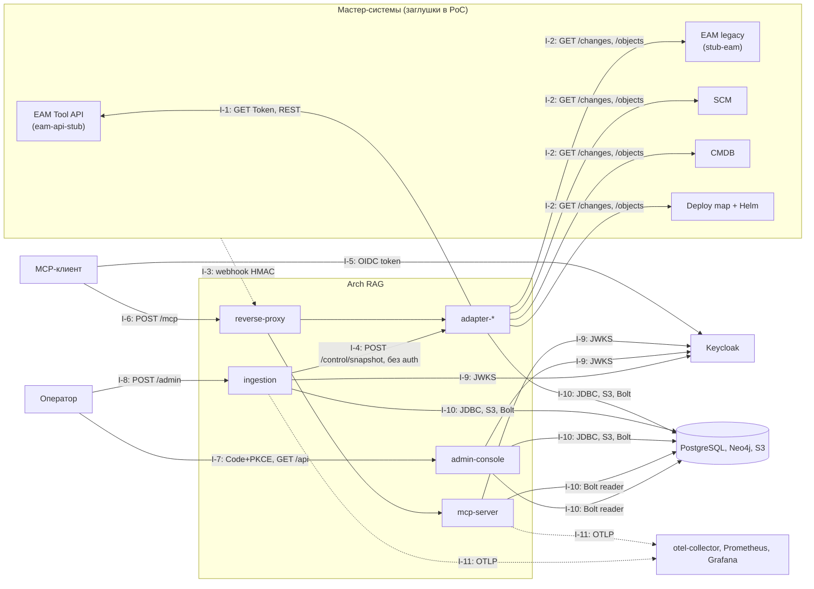

# Карта интеграций

> Architect, этап R.5 (UNLOCKER-270). Для каждой интеграции: направление, протокол, аутентификация, ссылка `файл:строка`. Контракты не дублируются: webhook и CloudEvent — `docs/03-interfaces.md` §3, §5.4; EAM — `docs/06-eam-integration.md`, `docs/eam-api.yaml`; ADR 0009, 0010. Диаграмма окружения — [`c4-context.md`](c4-context.md), контейнеры — [`c4-containers.md`](c4-containers.md). Метки: 🟢 код/конфиг · 🟡 выведено · 🔴 расхождение или пробел.
> Направление указано относительно Arch RAG: **→ внутрь** (нас вызывают), **← наружу** (мы вызываем).

## 1. Сводная карта

## 2. Мастер-системы (исходящие, polling и snapshot)

| # | Интеграция | Направление | Протокол и формат | Аутентификация | Лимиты и поведение | Основание |
|---|---|---|---|---|---|---|
| I-1 | EAM Tool API: `PLATFORM → SOLUTION → IT_SYSTEM` (`GET /api/<type>/…`) | ← наружу | REST/JSON, пагинация `page_size`, курсор `S`/`I`/`W` | заголовок `Authorization: Token <токен>`; токен обязателен, `401/403` → ошибка без тела | `page_size ≤ 500`; ≤ 10 запросов/с (`throttle`, интервал 100 мс); `429` — одно ожидание по `Retry-After`; `DELETE` не порождается — удаления находит snapshot | `adapters/eam-adapter/src/main/java/io/github/unlocker/archrag/eamadapter/EamApiConnector.java:81-81`; `adapters/eam-adapter/src/main/java/io/github/unlocker/archrag/eamadapter/EamApiConnector.java:45-56`; `docs/eam-api.yaml:1-1` 🟢 |
| I-2 | Универсальные источники: EAM legacy (только `TEAM`, `SERVICE_DEPENDENCY`), SCM, CMDB, Deploy map | ← наружу | REST `GET /changes?limit&cursor`, `GET /objects/{type}/{id}`; `429` и `5xx` → повтор по `RetryPolicy` (5 попыток, 500 мс…30 с) | в самом коннекторе аутентификации нет; граница — сеть `edge` (заглушки) | таймауты: соединение 5 с, запрос 10 с; источник только читается | `adapters/adapter-core/src/main/java/io/github/unlocker/archrag/adaptercore/HttpSourceConnector.java:56-72`; `adapters/adapter-core/src/main/java/io/github/unlocker/archrag/adaptercore/RetryPolicy.java:40-50` 🟢; для реальных систем 🔴 контракт аутентификации не определён (gap 3.5, [`tech-debt.md`](tech-debt.md)) |
| I-3 | Webhook источника → адаптер | → внутрь | `POST /webhook` (в compose через proxy `/webhooks/<eam\|scm\|cmdb\|deploymap>` с `rewrite` на `/webhook`), JSON ≤ 64 КБ; ответ без тела: `202`, `400`, `401`, `404`, `413`, `503` | HMAC-SHA256 над `timestamp + "." + body`; заголовки `X-Archrag-Signature: sha256=<hex>`, `X-Archrag-Timestamp`, `X-Archrag-Event-Id`; пустой секрет запрещён | окно повторов `DEFAULT_REPLAY_WINDOW` 5 мин; `eventId` из подписанного тела, заголовок только сверяется; повторов `RetryPolicy` в этом пути нет | `contracts/source-spi/src/main/java/io/github/unlocker/archrag/sourcespi/WebhookSignature.java:25-28`; `adapters/adapter-core/src/main/java/io/github/unlocker/archrag/adaptercore/WebhookHandler.java:56-65`; `platform/docker/proxy/nginx.conf:42-63` 🟢; заглушки шлют напрямую в адаптер по `edge` (`platform/docker/docker-compose.yml:387-387`) 🟡 |
| I-4 | Ручной reconcile: `ingestion` → адаптер `POST /control/snapshot` | ← наружу (из `ingestion`) | HTTP POST без тела, синхронный, таймаут 10 мин; ответы `202/409/503/500` | **не аутентифицируется**; защита только сетевая (`edge`/`backend`), proxy путь не публикует | держит `AdminLock` на всё время snapshot — диспетчер в это время не работает | `ingestion/ingestion-service/src/main/java/io/github/unlocker/archrag/ingestionservice/AdapterControlClient.java:20-20`; `adapters/adapter-core/src/main/java/io/github/unlocker/archrag/adaptercore/WebhookServer.java:56-56` 🟢 (П-15 в [`detective-gaps.md`](detective-gaps.md)) |

Нюансы, которые влияют на эксплуатацию:
- `EAM` — один источник и один snapshot, поэтому составной коннектор склеивает две половины: `eam-api` (платформы, решения, системы) и legacy (команды, зависимости); `snapshotComplete` ставится только на последней странице legacy-половины 🟢 (`adapters/eam-adapter/src/main/java/io/github/unlocker/archrag/eamadapter/CompositeEamConnector.java:50-70`). Откат на старый путь — `ARCHRAG_EAM_MODE=legacy` (`platform/docker/docker-compose.yml:311-336`) 🟢.
- Webhook-путь EAM в реальности не используется (в реальном EAM их нет), хотя `WebhookServer` для него стартует 🟡 (`_reversa_sdd/code-analysis.md:299-299`).
- Единственный экземпляр на источник: замок snapshot внутрипроцессный (`adapters/adapter-core/src/main/java/io/github/unlocker/archrag/adaptercore/Poller.java:50-50`), `deploy: replicas: 1` (`platform/docker/docker-compose.yml:330-330`) 🟢.

## 3. Аутентификация и OIDC

Keycloak 26.4 в режиме `start-dev`, realm `archrag` импортируется из `platform/docker/keycloak/archrag-realm.json` (`platform/docker/docker-compose.yml:137-176`) 🟢. Три контура принимают токены одного issuer, но разные audience:

| # | Интеграция | Направление | Клиент и поток | Что проверяется | Основание |
|---|---|---|---|---|---|
| I-5 | Получение токена агентом | ← наружу (клиент → Keycloak, через proxy `/realms/archrag/protocol/openid-connect/`) | `archrag-demo`, `client_credentials`; scope `architecture.read` по умолчанию, `architecture.admin` optional | админка Keycloak наружу не проксируется | `platform/docker/keycloak/archrag-realm.json:51-61`; `platform/docker/proxy/nginx.conf:34-38` 🟢 |
| I-9 | Проверка JWT ресурсами | ← наружу (к JWKS) | `mcp-server`: issuer + `aud = ARCHRAG_MCP_RESOURCE_URI`; `admin-console`: issuer + `aud = ARCHRAG_CONSOLE_RESOURCE_URI`; `ingestion`: issuer + `aud = ARCHRAG_ADMIN_RESOURCE_URI` + `azp ∈ allowed-clients` | без токена 401; нет scope 403 | `access/mcp-server/src/main/resources/application.yml:19-20`; `access/admin-console/src/main/resources/application.yml:15-15`; `ingestion/ingestion-service/src/main/resources/application.yml:17-17`; `ingestion/ingestion-service/src/main/resources/application.yml:22-22` 🟢 |
| I-7a | Вход оператора консоли | → внутрь | публичный клиент `archrag-admin-console`, Authorization Code + PKCE, redirect только `http://127.0.0.1:<порт>/*`; токены в памяти браузера (`InMemoryWebStorage`) | клиент консоли не входит в `allowed-clients` admin REST: токен консоли на `/admin/**` даёт 401 | `platform/docker/keycloak/archrag-realm.json:77-90`; `access/admin-ui/src/auth/authService.ts:39-80` 🟢 |

Метаданные для MCP-клиентов: `GET /.well-known/oauth-protected-resource` (RFC 9728, без токена): `resource`, `authorization_servers`, `scopes_supported`; в `WWW-Authenticate` ответа 403 есть `resource_metadata` 🟢 (`access/mcp-server/src/main/java/io/github/unlocker/archrag/mcpserver/security/McpSecurityConfiguration.java:51-60`; `access/mcp-server/src/main/java/io/github/unlocker/archrag/mcpserver/security/ToolScopeFilter.java:129-139`).

Известные ограничения PoC (в `docs/05-production-gap-list.md` п. 2.1, 2.2, 2.7):
- 🟡 Любой пользователь realm получает токен консоли: роль `archrag-console-admin` присвоена, но нигде не проверяется (ADR [0026](../docs/adr/0026-admin-console-readonly-loopback.md), П-9).
- 🟡 Один scope `architecture.read` на все tools, один `architecture.admin` на консоль и admin REST (П-9, П-10).
- 🟡 `initialize` и `tools/list` доступны любому токену с audience MCP (П-6; `access/mcp-server/src/test/java/io/github/unlocker/archrag/mcpserver/McpSecurityTest.java:96-96`).

## 4. MCP-клиенты

| # | Интеграция | Направление | Протокол | Аутентификация | Ограничения | Основание |
|---|---|---|---|---|---|---|
| I-6 | `POST /mcp` — Streamable HTTP, режим `STATELESS`; клиентский вход — `https://<хост>:8443/mcp` через TLS-proxy | → внутрь | JSON-RPC по MCP; 6 tools: `ping`, `search_assets`, `get_asset`, `explain_provenance`, `trace_dependencies`, `find_runtime_footprint` | Bearer JWT; scope `architecture.read` на каждый `tools/call` (fail-closed для неизвестного tool); аудит каждого вызова | тело ≤ 1 МБ; JSON-RPC batch запрещён; `maxDepth` 1…6 без clamp; потолки: 500 узлов, 50 путей, 5 с, 512 КБ; аннотации tools: `readOnlyHint=true`, `destructiveHint=false`, `idempotentHint=true`, `openWorldHint=false` | `access/mcp-server/src/main/resources/application.yml:11-11`; `access/mcp-server/src/main/java/io/github/unlocker/archrag/mcpserver/security/ToolScopeFilter.java:40-40`; `access/mcp-server/src/main/java/io/github/unlocker/archrag/mcpserver/tools/ExplainProvenanceTool.java:45-45`; `platform/docker/proxy/nginx.conf:20-27` 🟢 |

Дополнительно: `STATELESS` вместо `STREAMABLE`, названного в `docs/00-vision.md:555`, закреплено в ADR [0017](../docs/adr/0017-mcp-streamable-http.md) (уточнение UNLOCKER-224) 🔴 — видение не обновлено. Тексты источников в `get_asset` (`properties(n)`) отдаются агенту без пометки «недоверенные данные» 🟡 (`access/graph-query-core/src/main/java/io/github/unlocker/archrag/graphquerycore/templates/AssetTemplates.java:119-119`; `docs/05-production-gap-list.md` п. 2.6).

## 5. Админские и операторские интерфейсы

| # | Интеграция | Направление | Протокол | Аутентификация | Основание |
|---|---|---|---|---|---|
| I-7 | Консоль: SPA + `GET /api/graph/*`, `/api/sync/*`, `/api/identity/*`, `/api/audit`; публично только статика, `/console-config.json`, `/actuator/health/**` | → внутрь | HTTP на `127.0.0.1:8090` (TLS в PoC нет); только GET | JWT, `aud` консоли, scope `architecture.admin`; CSP `default-src 'self'` | `platform/docker/docker-compose.yml:291-293`; `access/admin-console/src/main/java/io/github/unlocker/archrag/adminconsole/security/ConsoleSecurityConfiguration.java:41-50`; `access/admin-console/src/main/java/io/github/unlocker/archrag/adminconsole/config/ConsoleConfigController.java:27-27` 🟢 |
| I-8 | Admin REST ingestion: `POST /admin/replay`, `/admin/rebuild?confirm=true`, `/admin/reconcile/{source}`, `/admin/crosswalks` | → внутрь, только внутри compose | HTTP, JSON | JWT, `aud` админки, scope `architecture.admin`, `azp ∈ allowed-clients` (по умолчанию `archrag-demo`); `/actuator` закрыт `denyAll()`; в `nginx.conf` нет `location /admin` | `ingestion/ingestion-service/src/main/java/io/github/unlocker/archrag/ingestionservice/AdminController.java:61-61`; `ingestion/ingestion-service/src/main/java/io/github/unlocker/archrag/ingestionservice/AdminController.java:117-117`; `ingestion/ingestion-service/src/main/java/io/github/unlocker/archrag/ingestionservice/SecurityConfiguration.java:42-43` 🟢 |

Консоль не вызывает `/admin/*`; replay, rebuild, reconcile и crosswalk доступны только оператору через admin REST (ADR [0013](../docs/adr/0013-operator-ops-via-admin-endpoint.md), [0026](../docs/adr/0026-admin-console-readonly-loopback.md)). `restore.sh` вызывает `/admin/replay` из контейнера `ingestion` с токеном `archrag-demo` ([`flowcharts/docker.md`](flowcharts/docker.md) §3) 🟢.

## 6. Хранилища

| # | Интеграция | Клиент → хранилище | Протокол | Аутентификация | Основание |
|---|---|---|---|---|---|
| I-10a | PostgreSQL | адаптеры и `ingestion` (запись), консоль (SELECT) | JDBC; Flyway при старте `ingestion` (V1–V7) | пароль PG из Docker secret; консоль — отдельная роль `archrag_console_ro` без записи (`readOnly`, `default_transaction_read_only = on`) | `ingestion/ingestion-service/src/main/java/io/github/unlocker/archrag/ingestionservice/IngestionServiceConfiguration.java:38-38`; `access/admin-console/src/main/java/io/github/unlocker/archrag/adminconsole/pg/ConsolePgConfiguration.java:30-30` 🟢 |
| I-10b | Neo4j | `ingestion` — writer `neo4j`; `mcp-server` и `admin-console` — reader `archrag_reader` | Bolt, `bolt+ssc://neo4j:7687` (TLS без проверки цепочки, допущение демо), один `Driver` на приложение | `AuthTokens.basic`; ролей в Community нет | `platform/docker/docker-compose.yml:191-191`; `platform/docker/docker-compose.yml:233-233`; `ingestion/ingestion-service/src/main/java/io/github/unlocker/archrag/ingestionservice/IngestionServiceConfiguration.java:69-69` 🟢 |
| I-10c | S3 (SeaweedFS) | адаптеры (put), `ingestion` (get, put tombstone) | AWS SDK v2, `forcePathStyle`, регион-заглушка `us-east-1`; ключ `raw/<source>/<sha256>`, чтение проверяет hash | ключи доступа из Docker secrets | `ingestion/event-journal/src/main/java/io/github/unlocker/archrag/eventjournal/S3RawPayloadStore.java:43-43`; `ingestion/event-journal/src/main/java/io/github/unlocker/archrag/eventjournal/S3RawPayloadStore.java:74-74` 🟢 |

## 7. Наблюдаемость

| # | Интеграция | Направление | Протокол | Основание |
|---|---|---|---|---|
| I-11 | Метрики `mcp-server` и `ingestion` → `otel-collector` → Prometheus → Grafana (`127.0.0.1:3000`) | ← наружу | OTLP/HTTP `:4318`, выключено по умолчанию, включается `ARCHRAG_OBSERVABILITY=true` и профилем `observability` | `platform/docker/docker-compose.yml:200-201`; `platform/docker/docker-compose.yml:235-236`; `access/mcp-server/src/main/resources/application.yml:55-61` 🟢 |

Метрики ingestion: `archrag.ingestion.events{source,status}`, gauge отставания `archrag.ingestion.sync.lag` и `archrag.ingestion.dlq.open` (🔴 второй не уменьшается, пока `dlq_entry.replayed_at` не заполняется, Р-3); у MCP — `archrag.mcp.tool.call` и `archrag.mcp.tool.rows` 🟢 (`_reversa_sdd/code-analysis.md:685-685`; `access/mcp-server/src/main/java/io/github/unlocker/archrag/mcpserver/audit/ToolCallAuditor.java:29-33`). Аудит-логи — отдельные логгеры `archrag.audit.mcp` и `archrag.audit.console`; у консоли в аудит не попадают 401/403 из Spring Security 🟡.

## 8. Открытые вопросы по интеграциям

1. 🔴 Контракты реальных EAM/SCM/CMDB/deploymap не проверены: аутентификация, пагинация, лимиты, объём (gap 3.5). Для CMDB и SCM даже способ аутентификации адаптера не определён.
2. 🟡 `POST /control/snapshot` без аутентификации (gap 4.2 и П-15): допустимо при `edge`/`backend` как границе, недопустимо при выводе адаптеров в общую сеть.
3. 🟡 Webhook-путь через proxy (`/webhooks/*`) заложен, но в стенде заглушки шлют напрямую в адаптер — путь «внешняя система → proxy → адаптер» проверен смоуком, но не нагрузкой (замеры — `docs/04-poc-measurements.md`).
4. 🟡 Задержка «источник → граф» определяется интервалом polling (30 с): p95 близок к порогу 30 с (gap 4.4).
