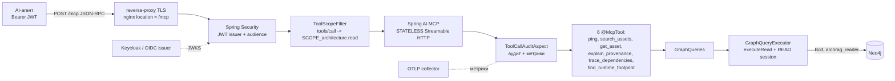

# access/mcp-server: требования

> Единственный внешний read-интерфейс витрины для AI-агентов (MCP, Streamable HTTP, stateless). Пути в трассировке развёрнуты до корня репозитория. Дизайн: [`design.md`](design.md); внешние контракты: [`contracts.md`](contracts.md); открытые вопросы: [`questions.md`](questions.md); решения: [`decisions.md`](decisions.md). Блок-схемы: [`../flowcharts/mcp-server.md`](../flowcharts/mcp-server.md).
> Use case-спецификации: [`authorize-tool-call/`](authorize-tool-call/requirements.md), [`search-get-asset/`](search-get-asset/requirements.md), [`explain-provenance/`](explain-provenance/requirements.md), [`trace-dependencies/`](trace-dependencies/requirements.md), [`find-runtime-footprint/`](find-runtime-footprint/requirements.md).

## Визуальная схема



## Visão Geral

`mcp-server` — Spring Boot-приложение (Spring AI MCP server, webmvc), которое публикует шесть предметных tools и один служебный (`ping`) на `POST /mcp`. Это OAuth2 resource server: каждый запрос несёт JWT (issuer + audience), на `tools/call` дополнительно проверяется scope из конфигурации. Данные читаются только из Neo4j фиксированными шаблонами `graph-query-core` под read-only учёткой `archrag_reader`; произвольного Cypher и записи нет. Каждый `tools/call` (включая отказ) оставляет одну аудит-запись и одно наблюдение Micrometer 🟢 (`access/mcp-server/src/main/java/io/github/unlocker/archrag/mcpserver/McpServerApplication.java:6-13`, `access/mcp-server/src/main/java/io/github/unlocker/archrag/mcpserver/security/McpSecurityConfiguration.java:16-22`).

## Responsabilidades

- Транспорт: Streamable HTTP в режиме `STATELESS` на `/mcp` (без сессий, ответы `application/json`); legacy SSE (`/sse`) не обслуживается 🟢 (`access/mcp-server/src/main/resources/application.yml:6-13`; `access/mcp-server/src/test/java/io/github/unlocker/archrag/mcpserver/McpServerInteropTest.java:77-116`).
- Аутентификация: JWT (issuer, audience), без сессий и CSRF; публичны только `/actuator/health/**` и `/.well-known/oauth-protected-resource/**` 🟢 (`access/mcp-server/src/main/java/io/github/unlocker/archrag/mcpserver/security/McpSecurityConfiguration.java:37-47`).
- Авторизация: `ToolScopeFilter` проверяет `SCOPE_<scope>` из `archrag.mcp.security.tool-scopes` на `tools/call`; неизвестный tool отклоняется (fail-closed) 🟢 (`access/mcp-server/src/main/java/io/github/unlocker/archrag/mcpserver/security/ToolScopeFilter.java:82-95`).
- Protected Resource Metadata (RFC 9728) на `/.well-known/oauth-protected-resource` 🟢 (`access/mcp-server/src/main/java/io/github/unlocker/archrag/mcpserver/security/McpSecurityConfiguration.java:48-60`).
- Шесть tools с валидацией аргументов, сборкой ответа-`record` и признаками `stale`/`truncated` 🟢 (см. use case).
- Единственный драйвер Neo4j (reader) и шаблоны запросов; потолки бюджета из `archrag.query.limits.*` 🟢 (`access/mcp-server/src/main/java/io/github/unlocker/archrag/mcpserver/graph/GraphReaderConfiguration.java:33-99`).
- Аудит-лог `archrag.audit.mcp` и метрики `archrag.mcp.tool.call`, `archrag.mcp.tool.rows` 🟢 (`access/mcp-server/src/main/java/io/github/unlocker/archrag/mcpserver/audit/ToolCallAuditor.java:27-120`).
- Health-пробы `liveness`/`readiness`; других actuator-эндпоинтов нет 🟢 (`access/mcp-server/src/main/resources/application.yml:73-80`; `access/mcp-server/src/test/java/io/github/unlocker/archrag/mcpserver/ActuatorProbesTest.java:30-50`).

## Regras de Negócio

- Каждый tool обязан иметь строку в `archrag.mcp.security.tool-scopes`, иначе вызов отклоняется `403` и пишется `DENIED_UNKNOWN_TOOL` 🟢 (`access/mcp-server/src/main/resources/application.yml:27-34`; `access/mcp-server/src/main/java/io/github/unlocker/archrag/mcpserver/security/ToolScopeFilter.java:84-90`).
- Все шесть tools требуют один scope `architecture.read`; градации «обычный/привилегированный» нет 🟢 (`access/mcp-server/src/main/resources/application.yml:28-34`).
- Scope проверяется только для метода `tools/call`; `initialize`, `tools/list` и прочие методы требуют лишь валидный токен с audience MCP 🟡 (`access/mcp-server/src/main/java/io/github/unlocker/archrag/mcpserver/security/ToolScopeFilter.java:82-96`; П-6).
- Проверка scope идёт в фильтре после `AuthorizationFilter`, а не правилом `authorizeHttpRequests`: сопоставление «имя tool → scope» берётся из тела JSON-RPC 🟢 (`access/mcp-server/src/main/java/io/github/unlocker/archrag/mcpserver/security/McpSecurityConfiguration.java:61`).
- Тело `POST /mcp` читается не более `max-request-bytes` (1 МБ): больше → `413`; невалидный JSON, не объект (в том числе JSON-RPC batch) или неподдерживаемая кодировка → `400` 🟢 (`access/mcp-server/src/main/java/io/github/unlocker/archrag/mcpserver/security/ToolScopeFilter.java:60-81`).
- Доступ к графу — только через `GraphQueries` → `GraphQueryExecutor` (`executeRead` в сессии `AccessMode.READ`, `EXPLAIN` обязан дать `READ_ONLY`); tool, обратившийся к исполнителю напрямую, выпадет из аудита 🟢 (`access/mcp-server/src/main/java/io/github/unlocker/archrag/mcpserver/graph/GraphQueries.java:10-31`; `access/graph-query-core/src/main/java/io/github/unlocker/archrag/graphquerycore/GraphQueryExecutor.java:35-36, 78-91, 99-122`).
- Бюджет запроса всегда зажимается потолками конфигурации (`clampTo`): глубина 6, строки 500, пути 50, таймаут 5 с, ответ 512 КБ 🟢 (`access/graph-query-core/src/main/java/io/github/unlocker/archrag/graphquerycore/ResultBudget.java:30-37`; `access/mcp-server/src/main/resources/application.yml:45-50`).
- Ввод пользователя не попадает в тексты ошибок tools (gid, property, relationType, environment не эхоятся) 🟢 (`access/mcp-server/src/main/java/io/github/unlocker/archrag/mcpserver/tools/GetAssetTool.java:94-101`; `access/mcp-server/src/main/java/io/github/unlocker/archrag/mcpserver/tools/ExplainProvenanceTool.java:99-108`).
- Исключение tool пробрасывается (аспект его не глушит) и клиенту приходит как `result.isError=true` при HTTP `200` 🟢 (`access/mcp-server/src/main/java/io/github/unlocker/archrag/mcpserver/audit/ToolCallAuditAspect.java:43-46`; `access/mcp-server/src/test/java/io/github/unlocker/archrag/mcpserver/SearchAssetsMcpTest.java:121-128`).
- Свежесть: узел/связь «устарели», если `lastSeenAt`/`fetchedAt` старше `archrag.query.stale-after` (по умолчанию `P7D`) либо не заданы 🟢 (`access/mcp-server/src/main/java/io/github/unlocker/archrag/mcpserver/graph/StalenessProperties.java:12-20`; `access/mcp-server/src/main/java/io/github/unlocker/archrag/mcpserver/tools/TraceDependenciesTool.java:187-190`).
- MCP-сервер не получает writer-учётных данных Neo4j, PostgreSQL и S3; в compose он в сетях `edge`, `graph`, `observability`, но не в `backend` 🟢 (`platform/docker/docker-compose.yml:230-240`).
- 🔴 Нет rate limiting и квот на агента: защита — только таймаут и бюджет запроса (`../tech-debt.md` 2.5).

## Requisitos Funcionais

| ID | Требование | Приоритет | Критерий приёмки |
|----|-----------|-----------|------------------|
| RF-01 | `POST /mcp` принимает JSON-RPC (Streamable HTTP, stateless): `initialize`, `tools/list`, `tools/call` без предварительного `initialize` | Must | AC-01; `McpServerInteropTest.initializeListAndCallPing`, `callWithoutInitializeWorksBecauseServerIsStateless` |
| RF-02 | JWT (issuer + audience) обязателен на все пути, кроме health и метаданных ресурса | Must | AC-02; `McpSecurityTest.requestWithoutTokenIsUnauthorizedWithMetadataPointer`, `foreignAudienceIssuerAndExpiredTokensAreUnauthorized` |
| RF-03 | `tools/call` разрешён только при наличии scope из `tool-scopes`; неизвестный tool → `403` | Must | [`authorize-tool-call`](authorize-tool-call/requirements.md) AC-02..AC-04 |
| RF-04 | Размер тела ≤ `max-request-bytes`; невалидное тело → `400`/`413` | Must | [`authorize-tool-call`](authorize-tool-call/requirements.md) AC-05, AC-06 |
| RF-05 | `GET /.well-known/oauth-protected-resource` публичен и отдаёт `resource`, `authorization_servers`, `scopes_supported`, `bearer_methods_supported=["header"]` | Must | AC-03; `McpSecurityTest.protectedResourceMetadataIsPublic` |
| RF-06 | `search_assets`, `get_asset` | Must | [`search-get-asset`](search-get-asset/requirements.md) |
| RF-07 | `explain_provenance` | Must | [`explain-provenance`](explain-provenance/requirements.md) |
| RF-08 | `trace_dependencies` (`mode=trace|impact`) | Must | [`trace-dependencies`](trace-dependencies/requirements.md) |
| RF-09 | `find_runtime_footprint` | Must | [`find-runtime-footprint`](find-runtime-footprint/requirements.md) |
| RF-10 | `ping` — служебный tool доступности | Should | AC-01; `McpServerInteropTest.initializeListAndCallPing` |
| RF-11 | Каждый `tools/call` оставляет ровно одну аудит-запись и одно наблюдение | Must | [`authorize-tool-call`](authorize-tool-call/requirements.md) AC-07, AC-08; `McpAuditTest` |
| RF-12 | Все tools помечены `readOnlyHint=true`, `destructiveHint=false`, `idempotentHint=true`, `openWorldHint=false` | Must | AC-04; `McpSecurityTest.toolsListMarksAllToolsReadOnly` |
| RF-13 | Только чтение графа (`executeRead`, `AccessMode.READ`, `EXPLAIN` = `READ_ONLY`) | Must | AC-05; `platform/integration-tests/src/test/java/io/github/unlocker/archrag/integrationtests/GraphQueryCoreIT.java:78-91` |
| RF-14 | `GET /actuator/health/liveness|readiness` публичны; `/actuator/env` не экспонируется | Should | AC-06; `ActuatorProbesTest` |

## Requisitos Não Funcionais

| Тип | Требование | Evidence | Уверенность |
|-----|------------|----------|-------------|
| Безопасность | Сессии `STATELESS`, CSRF отключён, всё кроме health и метаданных `authenticated()` | `access/mcp-server/src/main/java/io/github/unlocker/archrag/mcpserver/security/McpSecurityConfiguration.java:37-47` | 🟢 |
| Безопасность | audience обязателен: `spring.security.oauth2.resourceserver.jwt.audiences = archrag.mcp.security.resource-uri`, `ARCHRAG_MCP_RESOURCE_URI` без значения по умолчанию | `access/mcp-server/src/main/resources/application.yml:19-20, 25` | 🟢 |
| Безопасность | Секреты Neo4j reader не попадают в `toString`; пароль только из env/Docker secret | `access/mcp-server/src/main/java/io/github/unlocker/archrag/mcpserver/graph/GraphReaderProperties.java:17-21`; `access/mcp-server/src/main/resources/application.yml:36-41` | 🟢 |
| Безопасность | Токен и аргументы в теги метрик не попадают; имя неизвестного tool в метрике — `unknown`; в логе — санитизировано и ≤ 64 символов | `access/mcp-server/src/main/java/io/github/unlocker/archrag/mcpserver/audit/ToolCallAuditor.java:91-97, 122-129` | 🟢 |
| Безопасность | Аргументы в аудите: ключи отсортированы, строки ≤ 256, коллекции ≤ 20, глубина ≤ 5, ключи `token|secret|password|authorization|credential` маскируются `***` (эвристика) | `access/mcp-server/src/main/java/io/github/unlocker/archrag/mcpserver/audit/ToolArguments.java:18-27, 35-80` | 🟡 (П-14) |
| Безопасность | Read-only обеспечивает приложение, а не СУБД: учётка `archrag_reader` на Community писать технически может | `docs/adr/0005-readonly-mcp-by-application.md:28`; `_reversa_sdd/permissions.md` §3.3 | 🟡 (П-21) |
| Производительность | Таймаут транзакции 5 с, ответ ≤ 512 КБ, ≤ 500 строк, ≤ 50 путей, глубина ≤ 6 | `access/mcp-server/src/main/resources/application.yml:45-50` | 🟢 |
| Производительность | Latency tool измеряется по p95: гистограмма `archrag.mcp.tool.call` включена | `access/mcp-server/src/main/resources/application.yml:68-72` | 🟢 |
| Disponibilidade | Stateless: любой экземпляр обслуживает любой запрос, масштабирование `--scale mcp-server=2` | `access/mcp-server/src/main/resources/application.yml:11`; `platform/docker/docker-compose.yml:229` | 🟢 |
| Disponibilidade | Graceful shutdown, 20 с на фазу | `access/mcp-server/src/main/resources/application.yml:4-5, 52-53` | 🟢 |
| Disponibilidade | Драйвер Neo4j ленивый: приложение стартует без Neo4j, соединение открывается при первом запросе | `access/mcp-server/src/main/java/io/github/unlocker/archrag/mcpserver/graph/GraphReaderConfiguration.java:20-26`; `access/mcp-server/src/test/resources/config/application.yml:1-7` | 🟢 |
| Observabilidade | OTLP-экспорт метрик по умолчанию выключен, `service.name=mcp-server`, `service.instance.id=${HOSTNAME}` | `access/mcp-server/src/main/resources/application.yml:55-67` | 🟢 |
| Escalabilidade | Нет rate limiting и квот на агента | `_reversa_sdd/tech-debt.md` 2.5 | 🔴 |

> Inferido a partir do código. SLO (латентность, доступность) в модуле не заданы; измерения PoC — `docs/04-poc-measurements.md` 🟢 [R.8: ответ владельца, вопрос 12] (см. [`questions.md`](questions.md) Q-10).

## Критерии приёмки (сквозные)

```gherkin
# AC-01: транспорт, позитив
Дано запущен mcp-server, токен со scope architecture.read и нужным audience
Когда клиент без initialize вызывает POST /mcp tools/call ping
Тогда ответ 200 application/json, заголовка Mcp-Session-Id нет, result.isError = false и текст {"status":"ok"}
      # McpServerInteropTest.statelessTransportAnswersWithJsonEvenIfEventStreamIsAccepted

# AC-01n: транспорт, негатив
Дано токен валиден
Когда клиент делает GET /sse
Тогда 404 (legacy SSE не обслуживается)               # McpServerInteropTest.legacySseEndpointIsNotServed

# AC-02: аутентификация, негатив
Дано запрос без токена, либо токен с чужим audience/issuer, либо просроченный
Когда выполняется POST /mcp
Тогда 401 и WWW-Authenticate: Bearer ... resource_metadata=...    # McpSecurityTest.requestWithoutTokenIsUnauthorizedWithMetadataPointer, foreignAudienceIssuerAndExpiredTokensAreUnauthorized

# AC-03: метаданные ресурса, позитив
Дано любой клиент без токена
Когда GET /.well-known/oauth-protected-resource
Тогда 200 и resource = ARCHRAG_MCP_RESOURCE_URI, authorization_servers содержит issuer, scopes_supported содержит architecture.read, bearer_methods_supported = ["header"]

# AC-04: read-only аннотации
Дано токен без scope (достаточно валидного токена)
Когда tools/list
Тогда 6 tools, у каждого readOnlyHint=true, destructiveHint=false, idempotentHint=true, openWorldHint=false

# AC-05: read-only путь к графу
Дано шаблон, чей EXPLAIN даёт не READ_ONLY (например, CREATE)
Когда GraphQueryExecutor.execute вызывается первый раз
Тогда IllegalStateException "not read-only", запрос не исполняется, вердикт кэшируется   # GraphQueryCoreIT (access/graph-query-core, проверка на Neo4j)

# AC-06: health, позитив и негатив
Дано работающий сервис
Когда GET /actuator/health/liveness и /readiness без токена
Тогда 200 {"status":"UP"}
Когда GET /actuator/env с валидным токеном
Тогда 404                                             # ActuatorProbesTest.livenessAndReadinessAreUp, envEndpointIsNotExposed
```

## Prioridade (MoSCoW)

| Требование | MoSCoW | Justificativa |
|-----------|--------|---------------|
| Транспорт, JWT, scope, read-only (RF-01..05, RF-12, RF-13) | Must | Критерии готовности: tool закрыт scope'ом, MCP только читает (CLAUDE.md, ловушки 3, 13) |
| Четыре предметных tools + `get_asset` (RF-06..09) | Must | Содержимое витрины для агентов (ADR 0018) |
| Аудит и метрики (RF-11) | Must | Критерий приёмки 9 PoC: p95 по tool |
| `ping` (RF-10), health (RF-14) | Should | Диагностика и оркестрация |
| Rate limiting / квоты на агента | Won't | Нет в коде (🟢 [R.8: ответ владельца, вопрос 12] Q-09) |
| Сверка `@McpTool` ↔ `tool-scopes` при старте | Won't | Нет в коде (🔴 Q-04) |
| Градация scope (read/privileged) | Won't | Один scope на всё (🟡 Q-03) |

## Зависит от / Связанные спецификации

См. раздел «Зависит от / Связанные спецификации» в [`design.md`](design.md).

## Rastreabilidade de Código

| Файл | Класс | Покрытие |
|------|-------|----------|
| `access/mcp-server/src/main/java/io/github/unlocker/archrag/mcpserver/McpServerApplication.java` | `McpServerApplication` | 🟢 |
| `access/mcp-server/src/main/java/io/github/unlocker/archrag/mcpserver/security/McpSecurityConfiguration.java`, `access/mcp-server/src/main/java/io/github/unlocker/archrag/mcpserver/security/ToolScopeFilter.java`, `access/mcp-server/src/main/java/io/github/unlocker/archrag/mcpserver/security/McpSecurityProperties.java` | безопасность | 🟢 |
| `access/mcp-server/src/main/java/io/github/unlocker/archrag/mcpserver/tools/PingTool.java`, `access/mcp-server/src/main/java/io/github/unlocker/archrag/mcpserver/tools/SearchAssetsTool.java`, `access/mcp-server/src/main/java/io/github/unlocker/archrag/mcpserver/tools/GetAssetTool.java`, `access/mcp-server/src/main/java/io/github/unlocker/archrag/mcpserver/tools/ExplainProvenanceTool.java`, `access/mcp-server/src/main/java/io/github/unlocker/archrag/mcpserver/tools/TraceDependenciesTool.java`, `access/mcp-server/src/main/java/io/github/unlocker/archrag/mcpserver/tools/FindRuntimeFootprintTool.java` | tools | 🟢 |
| `access/mcp-server/src/main/java/io/github/unlocker/archrag/mcpserver/tools/SearchAssetsResult.java`, `access/mcp-server/src/main/java/io/github/unlocker/archrag/mcpserver/tools/GetAssetResult.java`, `access/mcp-server/src/main/java/io/github/unlocker/archrag/mcpserver/tools/ExplainProvenanceResult.java`, `access/mcp-server/src/main/java/io/github/unlocker/archrag/mcpserver/tools/TraceDependenciesResult.java`, `access/mcp-server/src/main/java/io/github/unlocker/archrag/mcpserver/tools/FindRuntimeFootprintResult.java` | ответы tools | 🟢 |
| `access/mcp-server/src/main/java/io/github/unlocker/archrag/mcpserver/audit/ToolCallAuditAspect.java`, `access/mcp-server/src/main/java/io/github/unlocker/archrag/mcpserver/audit/ToolCallAuditor.java`, `access/mcp-server/src/main/java/io/github/unlocker/archrag/mcpserver/audit/ToolCallContext.java`, `access/mcp-server/src/main/java/io/github/unlocker/archrag/mcpserver/audit/ToolArguments.java`, `access/mcp-server/src/main/java/io/github/unlocker/archrag/mcpserver/audit/ToolDecision.java` | аудит | 🟢 |
| `access/mcp-server/src/main/java/io/github/unlocker/archrag/mcpserver/graph/GraphReaderConfiguration.java`, `access/mcp-server/src/main/java/io/github/unlocker/archrag/mcpserver/graph/GraphReaderProperties.java`, `access/mcp-server/src/main/java/io/github/unlocker/archrag/mcpserver/graph/GraphQueries.java`, `access/mcp-server/src/main/java/io/github/unlocker/archrag/mcpserver/graph/StalenessProperties.java` | доступ к графу | 🟢 |
| `access/mcp-server/src/main/resources/application.yml`, `access/mcp-server/pom.xml` | конфигурация, сборка | 🟢 |
