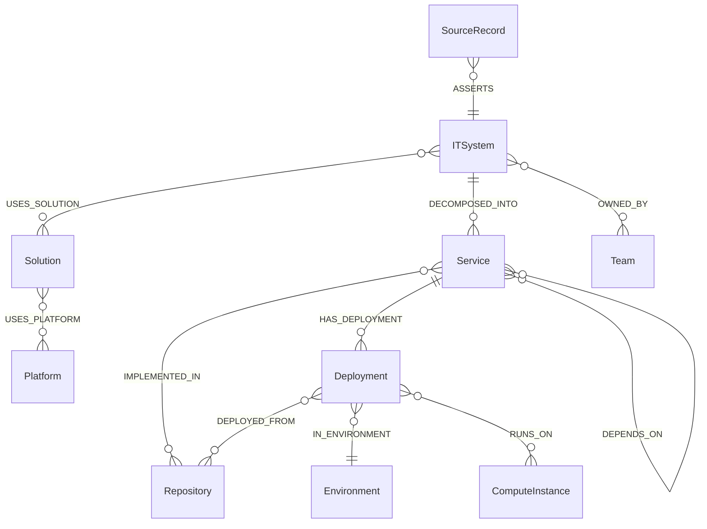

# Alma do Sistema → Душа системы

> Синтез Soul Extractor от 2026-10-12. Основа: `.reversa/context/surface.json`, `docs/00-vision.md`, `docs/adr/0001–0031`, выборочное чтение `contracts/canonical-model`, `git log`.
> Метки: 🟢 подтверждено в коде/ADR · 🟡 выведено · 🔴 пробел.

## 1. Назначение

Arch RAG — операционный граф знаний об архитектуре предприятия, а не «GraphRAG из документов»: мастер-системы остаются владельцами данных, Neo4j — производная read-only витрина, адаптеры поддерживают её актуальность, а MCP-сервер даёт ИИ-агентам ограниченный набор предметных read-only операций 🟢 (`docs/00-vision.md:21-32`, ADR [0001](../docs/adr/0001-neo4j-derived-read-model.md)). Потребители — ИИ-агенты (через MCP) и операторы (через read-only админ-консоль) 🟢. Ценность: агент отвечает на вопросы «что это за актив, от кого зависит, где развёрнут, кто это утверждает» по структурированным источникам, с provenance и без произвольного Cypher 🟢 (ADR [0018](../docs/adr/0018-domain-tools-not-arbitrary-cypher.md)). Статус — PoC на заглушках мастер-систем (ADR [0010](../docs/adr/0010-master-systems-are-stubs.md), [0022](../docs/adr/0022-out-of-poc-scope.md)) 🟢.

## 2. Центральные сущности

Модель задана перечислениями `NodeLabel` и `RelationType` в `contracts/canonical-model` 🟢
(`.../canonicalmodel/node/NodeLabel.java:13-29`, `.../relation/RelationType.java:12-27`).

| Сущность | Что представляет | Связи | Уверенность |
|---|---|---|---|
| `ITSystem` | ИТ-система предприятия (корень иерархии) | `USES_SOLUTION`→Solution, `DECOMPOSED_INTO`→Service, `OWNED_BY`→Team | 🟢 |
| `Solution` / `Platform` | Решение и платформа, на которой оно построено | `USES_PLATFORM` | 🟢 |
| `Service` | Сервис — единица разработки и развёртывания | `IMPLEMENTED_IN`→Repository, `HAS_DEPLOYMENT`→Deployment, `DEPENDS_ON`→Service, `OWNED_BY`→Team | 🟢 |
| `Repository` | Git-репозиторий исходного кода | цель `IMPLEMENTED_IN`, `DEPLOYED_FROM {commit}` | 🟢 |
| `Deployment` | Развёртывание сервиса в окружении | `IN_ENVIRONMENT`→Environment, `RUNS_ON`→ComputeInstance/Namespace, `DEPLOYED_FROM`→Repository | 🟢 |
| `Environment` / `ComputeInstance` (`VirtualMachine`, `PhysicalServer`) / `Namespace` / `KubernetesCluster` | Окружение и инфраструктура исполнения | `HOSTED_ON`, `PART_OF` | 🟢; `Namespace`/`KubernetesCluster` не наполняются в PoC (ADR [0011](../docs/adr/0011-namespace-cluster-modeled-not-populated.md)) |
| `Team` | Владелец систем и сервисов | цель `OWNED_BY` | 🟢 |
| `SourceSystem` / `SourceRecord` / `SyncRun` | Provenance: кто и когда утверждал факт | `OWNS_RECORD`, `ASSERTS`, `PROCESSED` | 🟢 |

Кардинальности — 🟡: перечисление хранит только допустимые пары меток (`RelationType.allows`), не множественность.
`temporal` у связей (`RelationType` третий параметр) — признак «закрываемой» связи с `Validity` (ADR [0020](../docs/adr/0020-tombstone-instead-of-hard-delete.md), [0028](../docs/adr/0028-structural-relations-temporal.md)) 🟢.

## 3. Основополагающие решения

### D1. Neo4j — производная read-only витрина; источник истины — мастер-системы
- **Evidence:** ADR [0001](../docs/adr/0001-neo4j-derived-read-model.md), [0002](../docs/adr/0002-four-contours.md) (четыре контура), `docs/00-vision.md:21-32`.
- **Implication:** граф можно целиком перестроить из журнала (replay/rebuild); любое изменение идёт через ingestion, а не через MCP.
- **Confidence:** 🟢

### D2. Идентичность: `gid` + `SourceRecord {source, sourceType, sourceId}`; `sourceId` — без префикса системы
- **Evidence:** ADR [0003](../docs/adr/0003-gid-and-source-record-identity.md), [0024](../docs/adr/0024-open-source-id-format.md); `contracts/canonical-model/.../canonicalmodel/provenance/SourceRecord.java`.
- **Implication:** актив подтверждается несколькими источниками; `MERGE` только по ключам под constraint.
- **Confidence:** 🟢

### D3. Postgres inbox как event backbone за интерфейсами `EventJournal`/`CanonicalEventPublisher`; raw payload в S3 (SeaweedFS)
- **Evidence:** ADR [0006](../docs/adr/0006-postgres-inbox-event-backbone.md), [0007](../docs/adr/0007-s3-raw-storage-seaweedfs.md); `ingestion/event-journal` (`PostgresEventJournal`, `S3RawPayloadStore`).
- **Implication:** Kafka — только production-вариант; идемпотентность по `source + eventId`, версия по `sourceVersion`.
- **Confidence:** 🟢

### D4. Authority matrix на уровне полей и связей; identity resolution без авто-слияния
- **Evidence:** ADR [0008](../docs/adr/0008-authority-matrix-field-level.md), [0019](../docs/adr/0019-identity-resolution-no-auto-merge.md), [0030](../docs/adr/0030-deployment-system-conflict.md), [0031](../docs/adr/0031-it-system-platform-invariant.md); `AuthorityMatrix.java`, `ingestion/identity-resolution` (`SourceConflict`).
- **Implication:** расхождения источников фиксируются как конфликты, а не молча перезаписываются.
- **Confidence:** 🟢

### D5. Tombstone вместо hard delete; удаление только после `snapshot-complete`; структурные связи темпоральны
- **Evidence:** ADR [0020](../docs/adr/0020-tombstone-instead-of-hard-delete.md), [0028](../docs/adr/0028-structural-relations-temporal.md); `TombstoneSourceRecord`, `CloseAssertion` в `canonical-model`.
- **Implication:** граф хранит историю; checkpoint двигается только после коммита Neo4j.
- **Confidence:** 🟢

### D6. Агентам — предметные tools с параметризованными шаблонами; read-only обеспечивает приложение, не Neo4j Community
- **Evidence:** ADR [0004](../docs/adr/0004-neo4j-community-constraints.md), [0005](../docs/adr/0005-readonly-mcp-by-application.md), [0012](../docs/adr/0012-trace-dependencies-impact-mode.md), [0017](../docs/adr/0017-mcp-streamable-http.md), [0018](../docs/adr/0018-domain-tools-not-arbitrary-cypher.md); `access/graph-query-core` (`QueryTemplateRegistry`, `QueryLimits`), `access/mcp-server` (`ToolScopeFilter`).
- **Implication:** любой новый tool = новый шаблон + scope в Spring Security; MCP — Streamable HTTP в режиме `STATELESS` (🟡 `docs/00-vision.md:555` называет `STREAMABLE`, код и ADR 0017 — `STATELESS`).
- **Confidence:** 🟢

### D7. Java 21 + Spring Boot 4 + Spring AI 2 + Maven multi-module; четыре контура как модули; Docker Compose стенд
- **Evidence:** ADR [0015](../docs/adr/0015-java21-spring-maven-stack.md), [0016](../docs/adr/0016-archrag-coordinates.md), [0021](../docs/adr/0021-compose-demo-stand.md), [0026](../docs/adr/0026-admin-console-readonly-loopback.md), [0027](../docs/adr/0027-frontend-react-typescript-webpack.md); корневой `pom.xml:15-21`.
- **Implication:** направление зависимостей `contracts ← adapters/ingestion/access ← platform`; access не зависит от ingestion.
- **Confidence:** 🟢

### D8. Мастер-системы в PoC — заглушки; `Deployment` берётся из deploy map + Helm charts
- **Evidence:** ADR [0009](../docs/adr/0009-deployment-from-deploymap.md), [0010](../docs/adr/0010-master-systems-are-stubs.md), [0029](../docs/adr/0029-helm-chart-system-repo-commit.md); `platform/source-stubs`, `adapters/deploymap-adapter`.
- **Implication:** реальные интеграции вне PoC; форматы источников задаёт код заглушек.
- **Confidence:** 🟢

Процесс: ветвление `develop → epic/<parent> → feature/<child>`, ADR [0023](../docs/adr/0023-branching-process.md) 🟢.

## 4. Пробелы и вопросы

1. 🔴 Задача R.1 ссылается на ADR 0001–0028, в `docs/adr/` их 31 (0029–0031 от 2026-10-10…12). Soul охватывает все 31; подтвердить, что так и нужно.
2. 🔴 `docs/00-vision.md:555` называет `protocol=STREAMABLE`, код — `STATELESS` (ADR 0017 уточнён 2026-10-07, UNLOCKER-224). Само видение не обновлено.
3. 🟡 Раскладка модулей шире схемы «Java-модули» в `docs/00-vision.md:453` (`adapter-core`, `event-journal`, `ingestion-service`, `admin-console`, `admin-ui`, `source-stubs`, `demo-launcher`); нужно ли отразить их в видении?
4. 🟡 Кардинальности связей в модели не хранятся — их выяснит Archaeologist (R.2a) по `GraphProjector`/`Neo4jSchema`.

## 5. Как читать

Soul — краткая сводка. Детали: `inventory.md` (поверхность, модули), `dependencies.md` (версии, граф зависимостей), далее Archaeologist (по модулям), Detective (правила и ADR), Architect (C4/ERD).
