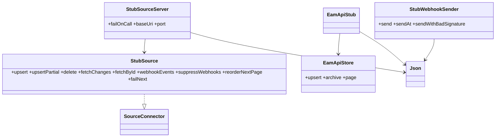

# platform/source-stubs: дизайн

> Ссылки даны полными путями от корня репозитория Требования: [`requirements.md`](requirements.md). Контракты: [`contracts.md`](contracts.md).
> Use case-спецификации: [`stub-source-journal/`](stub-source-journal/design.md), [`stub-source-http/`](stub-source-http/design.md), [`eam-api-stub/`](eam-api-stub/design.md), [`signed-webhook/`](signed-webhook/design.md).

## Интерфейс

Пакет `io.github.unlocker.archrag.sourcestubs`. Публичные классы: `StubSource`, `StubSources`, `DeployMapFormat`, `StubSourceServer`, `EamApiStub`, `EamApiStore`, `EamApiSeed`, `EamApiFormat`, `StubWebhookSender`; package-private: `Json`, `EamApiTypeMeta` 🟢. HTTP-контракт — в [`contracts.md`](contracts.md).

| Символ | Сигнатура | Результат / исключения | Трассировка |
|--------|-----------|------------------------|-------------|
| `StubSource(system, clock)` | `(SourceSystem, Clock)` | реализует `SourceConnector`; все публичные методы `synchronized` | `platform/source-stubs/src/main/java/io/github/unlocker/archrag/sourcestubs/StubSource.java:29, 43-46` 🟢 |
| `StubSource.upsert` / `upsertPartial` / `delete` | `(type, id, Map)` / `(type, id)` → `SourceChange` | новое состояние; версия +1 | `platform/source-stubs/src/main/java/io/github/unlocker/archrag/sourcestubs/StubSource.java:54-70` 🟢 |
| `StubSource.fetchChanges` | `(String cursor, int limit) -> ChangePage` | `IllegalArgumentException` (`limit ≤ 0`, неизвестный префикс курсора); `SourceUnavailableException` по `failNext`; `NumberFormatException` / `ArrayIndexOutOfBoundsException` на битом курсоре (не перехвачены) | `platform/source-stubs/src/main/java/io/github/unlocker/archrag/sourcestubs/StubSource.java:107-168` 🟢 |
| `StubSource.fetchById` | `(type, id) -> Optional<SourceChange>` | последняя запись ключа, включая `DELETE`; `SourceUnavailableException` по `failNext` | `platform/source-stubs/src/main/java/io/github/unlocker/archrag/sourcestubs/StubSource.java:170-180` 🟢 |
| `StubSource.webhookEvents` | `() -> List<WebhookEvent>` | уведомления в порядке возникновения без подавленных; `eventId = "<код>-evt-<seq>"` | `platform/source-stubs/src/main/java/io/github/unlocker/archrag/sourcestubs/StubSource.java:98-105, 192-202` 🟢 |
| `StubSource.suppressWebhooks` / `reorderNextPage` / `failNext` | `(boolean)` / `()` / `(int times, int status, Duration retryAfter)` | сценарные ручки | `platform/source-stubs/src/main/java/io/github/unlocker/archrag/sourcestubs/StubSource.java:72-96` 🟢 |
| `StubSources.seeded` / `eam` / `scm` / `cmdb` / `deployMap` | `(Clock) -> Map<SourceSystem,StubSource>` / `StubSource` | seed | `platform/source-stubs/src/main/java/io/github/unlocker/archrag/sourcestubs/StubSources.java:28-105` 🟢 |
| `StubSources.addDeploymentWithUnknownRepository` / `...WithSystemMismatch` / `...WithInvalidCommit` / `...Redeploy` / `addServiceWithBrokenReference` | `(StubSource) -> String id` | негативные и сценарные хелперы, вне seed | `platform/source-stubs/src/main/java/io/github/unlocker/archrag/sourcestubs/StubSources.java:116-178, 202-211` 🟢 |
| `StubSources.fields` | `(Object... kv) -> Map<String,Object>` | `LinkedHashMap`; допускает `null`-значения; нечётное число аргументов даёт `ArrayIndexOutOfBoundsException` | `platform/source-stubs/src/main/java/io/github/unlocker/archrag/sourcestubs/StubSources.java:213-220` 🟡 |
| `StubSourceServer(source[, address])` | | запускает `HttpServer`; `IllegalStateException`, если порт занят | `platform/source-stubs/src/main/java/io/github/unlocker/archrag/sourcestubs/StubSourceServer.java:41-56` 🟢 |
| `StubSourceServer.failOnCall` | `(int callNumber, int status, Duration retryAfter)` | расписание сбоя по номеру вызова | `platform/source-stubs/src/main/java/io/github/unlocker/archrag/sourcestubs/StubSourceServer.java:68-77` 🟢 |
| `StubSourceServer.baseUri` / `port` / `close` | | `http://127.0.0.1:<port>`; `server.stop(0)` | `platform/source-stubs/src/main/java/io/github/unlocker/archrag/sourcestubs/StubSourceServer.java:58-66, 177-180` 🟢 |
| `EamApiStub(store, token[, address])` | | `IllegalArgumentException("token must not be blank")` | `platform/source-stubs/src/main/java/io/github/unlocker/archrag/sourcestubs/EamApiStub.java:49-67` 🟢 |
| `EamApiStore.upsert` / `archive` / `findIdByAttr` / `version` | | управляющие методы для тестов; `hasType`, `find`, `page` — package-private | `platform/source-stubs/src/main/java/io/github/unlocker/archrag/sourcestubs/EamApiStore.java:27-66` 🟢 |
| `EamApiSeed.seeded` | `(Clock) -> EamApiStore` | 6 объектов (2 платформы, 2 решения, 2 системы) | `platform/source-stubs/src/main/java/io/github/unlocker/archrag/sourcestubs/EamApiSeed.java:48-68` 🟢 |
| `EamApiFormat.parse` / `parseArchObjects` / `checkArchObject` / `id` / `ver` / `attrs` / `isLastPage` | | разбор и проверка `ArchObject` | `platform/source-stubs/src/main/java/io/github/unlocker/archrag/sourcestubs/EamApiFormat.java:17-82` 🟢 |
| `StubWebhookSender.send` / `sendAt` / `sendWithBadSignature` | `(WebhookEvent[, Instant]) -> int` | HTTP-статус; `IllegalStateException` при сетевой ошибке | `platform/source-stubs/src/main/java/io/github/unlocker/archrag/sourcestubs/StubWebhookSender.java:39-56` 🟢 |
| `Json.write` / `Json.parse` | `(Object) -> String` / `(String) -> Object` | `IllegalArgumentException` на структурных ошибках | `platform/source-stubs/src/main/java/io/github/unlocker/archrag/sourcestubs/Json.java:14-29` 🟢 |

## Структура

## Потоки данных

1. **Сценарий теста**: тест создаёт `StubSource` (через `StubSources.seeded`), оборачивает в `StubSourceServer` и отдаёт `baseUri()` адаптеру; изменения вносит прямыми вызовами `upsert/delete` 🟢 (`platform/source-stubs/src/main/java/io/github/unlocker/archrag/sourcestubs/StubSources.java:28-36`; `platform/source-stubs/src/main/java/io/github/unlocker/archrag/sourcestubs/StubSourceServer.java:41-44`).
2. **Чтение адаптером**: `GET /changes?cursor=&limit=` → `StubSource.fetchChanges` → `Json.write(pageJson)`; `GET /objects/{type}/{id}` → `fetchById` 🟢 (`platform/source-stubs/src/main/java/io/github/unlocker/archrag/sourcestubs/StubSourceServer.java:79-100`).
3. **Webhook**: тест берёт `source.webhookEvents().getLast()` и передаёт в `StubWebhookSender.send` → `POST` на endpoint адаптера; адаптер читает объект через `GET /objects/...` 🟢 (`platform/source-stubs/src/main/java/io/github/unlocker/archrag/sourcestubs/StubWebhookSender.java:39-49`; сценарий — `platform/integration-tests/src/test/java/io/github/unlocker/archrag/integrationtests/SyncAcceptanceIT.java:296-300`).
4. **EAM API**: тест создаёт `EamApiSeed.seeded(clock)` → `new EamApiStub(store, token)`; изменения — `store.upsert/archive`; адаптер читает `GET /api/<type>/` постранично 🟢 (`platform/integration-tests/src/test/java/io/github/unlocker/archrag/integrationtests/EamApiSupport.java:24-27`).

## Алгоритмы и встроенные правила

- **Курсор** непрозрачен для потребителя; внутренний формат `i<seq>` (инкремент) и `s<after>:<bound>` (продолжение snapshot); `null` — начало snapshot. Полная грамматика — [`contracts.md`](contracts.md) §1.2 🟢 (`platform/source-stubs/src/main/java/io/github/unlocker/archrag/sourcestubs/StubSource.java:113-143`).
- **Snapshot**: `byKey` — последняя запись ключа с `seq ≤ bound`; `latest` — только `UPSERT`, отсортированные по `seq`; страница — первые `limit` с `seq > after`; следующий курсор `s<last>:<bound>` пока в `latest` есть `seq > last`, иначе `i<bound>` 🟢 (`platform/source-stubs/src/main/java/io/github/unlocker/archrag/sourcestubs/StubSource.java:144-167`).
- **Перестановка**: единожды (`reorderNextPage`) непустая инкрементальная страница разворачивается и в конец добавляется дубль первой исходной записи; `nextCursor` и `hasMore` считаются по исходному `last` 🟢 (`platform/source-stubs/src/main/java/io/github/unlocker/archrag/sourcestubs/StubSource.java:123-130`).
- **Расписание сбоев HTTP** (`failOnCall`): счётчик `calls` растёт на каждом `GET` к обеим ручкам (в т. ч. на запросах, закончившихся `404`/`400`), хранится `ConcurrentHashMap<Integer, SourceUnavailableException>`, сработавший сбой удаляется 🟢 (`platform/source-stubs/src/main/java/io/github/unlocker/archrag/sourcestubs/StubSourceServer.java:37-39, 109-111, 129-134`). Не-`GET` счётчик не увеличивает 🟢 (`platform/source-stubs/src/main/java/io/github/unlocker/archrag/sourcestubs/StubSourceServer.java:107-108`).
- **EAM API: `ver`**: нового объекта `ver = 1`; при изменении `attrs` (сравнение `Map.equals`) `ver + 1`, `ctime` прежний, `mtime = now`, `attrs` заменяются целиком; при равных `attrs` ничего не меняется 🟢 (`platform/source-stubs/src/main/java/io/github/unlocker/archrag/sourcestubs/EamApiStore.java:27-37`).
- **EAM API: страница**: сортировка списком ключей `id|ctime|mtime` с префиксом `-`; хвост всегда по `id`; страница вне диапазона — пустой список 🟢 (`platform/source-stubs/src/main/java/io/github/unlocker/archrag/sourcestubs/EamApiStore.java:68-93`).
- **Webhook**: тело — `Json.write` восьми полей-уведомления; подпись по `timestamp.epochSecond` 🟢 (`platform/source-stubs/src/main/java/io/github/unlocker/archrag/sourcestubs/StubWebhookSender.java:44-49, 58-69`).

## Конфигурация и константы

Конфигурации нет: параметры передаются конструкторами и вызовами. Константы: `DEFAULT_LIMIT = 100` (`platform/source-stubs/src/main/java/io/github/unlocker/archrag/sourcestubs/StubSourceServer.java:33`); `DEFAULT_PAGE_SIZE = 50`, `MAX_PAGE_SIZE = 500` (`platform/source-stubs/src/main/java/io/github/unlocker/archrag/sourcestubs/EamApiStub.java:38-41`); типы EAM `platforms=11`, `itproducts=13`, `itsystems=12` (`platform/source-stubs/src/main/java/io/github/unlocker/archrag/sourcestubs/EamApiSeed.java:30`); таймауты webhook 5 с / 10 с (`platform/source-stubs/src/main/java/io/github/unlocker/archrag/sourcestubs/StubWebhookSender.java:26-27, 74`) 🟢. Значения лимитов и формат метаданных типов EAM — допущения «не подтверждено» (`platform/source-stubs/src/main/java/io/github/unlocker/archrag/sourcestubs/EamApiStub.java:34`; `docs/06-eam-integration.md:96`).

## Зависит от / Связанные спецификации

- Внутренние зависимости: только `contracts/source-spi` (`ChangePage`, `SourceChange`, `SourceConnector`, `SourceSystem`, `SourceUnavailableException`, `WebhookEvent`, `WebhookSignature`) — [`../source-spi/design.md`](../source-spi/design.md) 🟢.
- Потребители (Maven `test`-scope): `adapters/adapter-core`, `adapters/eam-adapter`, `adapters/scm-adapter`, `adapters/asset-adapter`, `adapters/deploymap-adapter`, `ingestion/normalizer`, `platform/integration-tests`; в основном scope — `platform/demo-launcher` (`adapters/eam-adapter/pom.xml:31-35`; `ingestion/normalizer/pom.xml:30-34`; `platform/integration-tests/pom.xml:38-42`; `platform/demo-launcher/pom.xml:50-53`) 🟢. Это скрытая зависимость тестов от главной сборки: узкий `-pl <adapter> verify` собирает заглушки только вместе с `-am` 🟡 (Н-15 в [`../tech-debt.md`](../tech-debt.md)).
- Направление зависимостей соблюдено: `source-stubs` → `contracts/source-spi`; ничего из `adapters/`, `ingestion/`, `access/` модуль не импортирует 🟢 (`platform/source-stubs/pom.xml:18-21`).

## Decisões de Design Identificadas

| Решение | Evidence | Уверенность |
|---------|----------|-------------|
| Заглушки — реальный JDK `HttpServer`, а не мок-клиент, чтобы REST-адаптеры проходили сетевой путь | `platform/source-stubs/src/main/java/io/github/unlocker/archrag/sourcestubs/StubSourceServer.java:49`; `platform/source-stubs/src/main/java/io/github/unlocker/archrag/sourcestubs/EamApiStub.java:61` | 🟢 (ADR 0010 [`../../docs/adr/0010-master-systems-are-stubs.md`](../../docs/adr/0010-master-systems-are-stubs.md)) |
| Собственный JSON вместо библиотеки: модуль зависит только от `source-spi` | `platform/source-stubs/pom.xml:18-21`; `platform/source-stubs/src/main/java/io/github/unlocker/archrag/sourcestubs/Json.java:9` | 🟡 (мотив не записан, выведен) |
| Версия на ключ растёт и на `DELETE` | `platform/source-stubs/src/main/java/io/github/unlocker/archrag/sourcestubs/StubSource.java:185` | 🟢 |
| Уведомление webhook без состояния объекта: состояние адаптер читает по `GET /objects` | `platform/source-stubs/src/main/java/io/github/unlocker/archrag/sourcestubs/StubWebhookSender.java:58-69`; `contracts/source-spi/src/main/java/io/github/unlocker/archrag/sourcespi/WebhookEvent.java:6-8` | 🟢 |
| Негативные сценарии deploy map — отдельные хелперы, вне seed | `platform/source-stubs/src/main/java/io/github/unlocker/archrag/sourcestubs/StubSources.java:116-178` | 🟢 |
| Заглушка EAM API хранит `ver` только по факту изменения `attrs` и физически удаляет архивные объекты | `platform/source-stubs/src/main/java/io/github/unlocker/archrag/sourcestubs/EamApiStore.java:13-16, 39-45`; `docs/06-eam-integration.md:94` | 🟢 (допущение, подтверждено владельцем 2026-10-10) |

## Observabilidade

Логов и метрик нет. Диагностика — только HTTP-статусы и исключения; сообщение `SourceUnavailableException` содержит код источника и статус (`contracts/source-spi/src/main/java/io/github/unlocker/archrag/sourcespi/SourceUnavailableException.java:18-20`) 🟢.

## Riscos e Lacunas

- 🔴 Необработанные исключения в `StubSourceServer` (курсор `s5`) и `EamApiStub` (`sort=","`) дают обрыв соединения вместо `400` — Q-01, Q-02.
- 🔴 `EamApiStub` уже контракта `docs/eam-api.yaml`: `kind ∈ {fields, system}` против `{computed, fields, groups, system}`; параметры `search`, `search_by`, `search_mode`, `enrich`, `only_names` игнорируются — Q-03.
- 🔴 Javadoc `DeployMapFormat` и `docs/03-interfaces.md` расходятся с фактическим payload seed — Q-04.
- 🟡 O(N·N/limit) на snapshot и неограниченный журнал — Q-10.
- 🟡 `StubSourceServer.baseUri()` всегда `127.0.0.1`, даже если сервер слушает `0.0.0.0` (`platform/source-stubs/src/main/java/io/github/unlocker/archrag/sourcestubs/StubSourceServer.java:58-61`) — Q-11.
- 🟡 `fields(Object...)` падает на нечётном числе аргументов (`platform/source-stubs/src/main/java/io/github/unlocker/archrag/sourcestubs/StubSources.java:216-218`) — Q-09.
