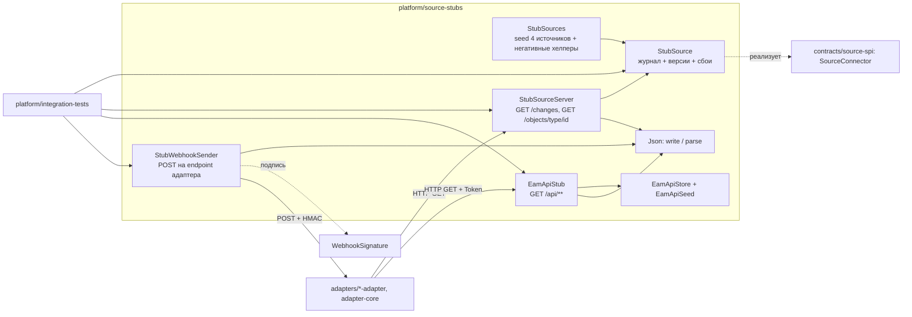

# platform/source-stubs: требования

> Библиотека заглушек мастер-систем PoC (не запускаемое приложение, не часть прод-контура). Пути в трассировке развёрнуты до корня репозитория. Дизайн: [`design.md`](design.md); внешние контракты (wire-формат): [`contracts.md`](contracts.md); открытые вопросы: [`questions.md`](questions.md); решения: [`decisions.md`](decisions.md); задачи: [`tasks.md`](tasks.md).
> Use case-спецификации: [`stub-source-journal/`](stub-source-journal/requirements.md), [`stub-source-http/`](stub-source-http/requirements.md), [`eam-api-stub/`](eam-api-stub/requirements.md), [`signed-webhook/`](signed-webhook/requirements.md).
> Входные материалы: [`../flowcharts/source-stubs.md`](../flowcharts/source-stubs.md), [`../code-analysis.md`](../code-analysis.md) §Y1, [`../data-dictionary.md`](../data-dictionary.md) §Y.1, [`../traceability/spec-impact-matrix.md`](../traceability/spec-impact-matrix.md) (строка `platform/source-stubs`, §2 № 2, № 16).

## Визуальная схема



## Visão Geral

`platform/source-stubs` заменяет мастер-системы (EAM, SCM, CMDB, deploy map) в тестах и на демо-стенде. Модуль даёт: (а) управляемую in-memory заглушку любой из четырёх систем, реализующую `SourceConnector`, с журналом изменений, монотонными версиями, snapshot/инкрементальными курсорами и сценарными ручками (подавленные webhook, перестановка страницы, сбои 429/5xx/timeout); (б) HTTP-фасад этой заглушки на JDK `HttpServer`; (в) отдельную заглушку реального EAM API в формате `ArchObject`; (г) отправитель подписанных webhook, включая негативные варианты; (д) собственный мини-парсер JSON. Зависит только от `contracts/source-spi` 🟢 (`platform/source-stubs/pom.xml:18-21`; `platform/source-stubs/src/main/java/io/github/unlocker/archrag/sourcestubs/package-info.java:1-6`). Заглушки не входят в прод-контур 🟢 (`docs/03-interfaces.md:525`).

## Responsabilidades

- Хранить состояние объектов источника как журнал изменений с версией на ключ `(sourceType, sourceId)` и отдавать его через `fetchChanges` / `fetchById` 🟢.
- Давать тестам управляющие ручки сценариев: `upsert`, `upsertPartial`, `delete`, `suppressWebhooks`, `reorderNextPage`, `failNext`, `failOnCall`, `archive` (EAM API) 🟢.
- Поднимать HTTP-слои, неотличимые для REST-адаптеров от реального источника по форме запроса и ответа 🟢.
- Предоставлять согласованные seed-данные четырёх источников, у которых идентификаторы ссылаются друг на друга 🟢.
- Подписывать и отправлять webhook по контракту `WebhookSignature` 🟢.
- Не писать в источник через HTTP (все изменяющие методы отвергаются) и не логировать ничего: в модуле нет логирования 🟢.

## Regras de Negócio

- Версия объекта растёт на 1 при каждой записи ключа, включая `DELETE`; после удаления нумерация продолжается 🟢 (`platform/source-stubs/src/main/java/io/github/unlocker/archrag/sourcestubs/StubSource.java:182-190`).
- Для `DELETE` payload пуст, `completeness = COMPLETE` 🟢 (`platform/source-stubs/src/main/java/io/github/unlocker/archrag/sourcestubs/StubSource.java:67-70`; инвариант `contracts/source-spi/src/main/java/io/github/unlocker/archrag/sourcespi/SourceChange.java:12-14`).
- `null`-значения payload сохраняются в `PARTIAL`-записи: это модель «поле не передано» 🟢 (`platform/source-stubs/src/main/java/io/github/unlocker/archrag/sourcestubs/StubSource.java:58-65`; `contracts/source-spi/src/main/java/io/github/unlocker/archrag/sourcespi/SourceChange.java:39-41`).
- Snapshot (`cursor == null`) отдаёт последнюю `UPSERT`-запись каждого ключа на момент `bound = размер журнала`; удалённые объекты в snapshot отсутствуют; объекты, изменённые после `bound`, приходят инкрементом 🟢 (`platform/source-stubs/src/main/java/io/github/unlocker/archrag/sourcestubs/StubSource.java:132-167`).
- `snapshotComplete = true` только на последней странице snapshot; инвариант `ChangePage` не допускает `snapshotComplete && hasMore` 🟢 (`platform/source-stubs/src/main/java/io/github/unlocker/archrag/sourcestubs/StubSource.java:164-167`; `contracts/source-spi/src/main/java/io/github/unlocker/archrag/sourcespi/ChangePage.java:20-25`).
- `fetchById` возвращает последнюю запись ключа, включая `DELETE`; пусто только для неизвестного ключа 🟢 (`platform/source-stubs/src/main/java/io/github/unlocker/archrag/sourcestubs/StubSource.java:170-180`).
- Сбой (`failNext`) отнимает счётчик только на допустимом вызове (`limit > 0` проверяется раньше) 🟢 (`platform/source-stubs/src/main/java/io/github/unlocker/archrag/sourcestubs/StubSource.java:108-112, 204-209`).
- HTTP: не-`GET` → `405 {}`; ошибки источника → его статус (`0` → `504`) с `Retry-After` в секундах; `IllegalArgumentException` → `400 {}`; тела ошибок не содержат введённых значений 🟢 (`platform/source-stubs/src/main/java/io/github/unlocker/archrag/sourcestubs/StubSourceServer.java:102-127`).
- EAM API: токен обязателен (`Authorization: Token <token>`), сравнение в постоянное время; пустой токен при создании запрещён; изменяющие методы → `405`; `page_size` зажат до 500 🟢 (`platform/source-stubs/src/main/java/io/github/unlocker/archrag/sourcestubs/EamApiStub.java:54-57, 92-98, 124, 186-191`).
- Тело webhook содержит только уведомление (без состояния объекта); подпись `sha256=HMAC(ts + "." + body)` 🟢 (`platform/source-stubs/src/main/java/io/github/unlocker/archrag/sourcestubs/StubWebhookSender.java:58-69`; `contracts/source-spi/src/main/java/io/github/unlocker/archrag/sourcespi/WebhookSignature.java:46-49`).
- Время хранится как `Instant` UTC от инжектируемого `Clock` 🟢 (`platform/source-stubs/src/main/java/io/github/unlocker/archrag/sourcestubs/StubSource.java:187`; `platform/source-stubs/src/main/java/io/github/unlocker/archrag/sourcestubs/EamApiStore.java:30`).
- 🟡 Корректность HTTP-слоя при параллельных запросах держится на допущении «последовательная обработка»: executor у `HttpServer` не задан (`platform/source-stubs/src/main/java/io/github/unlocker/archrag/sourcestubs/StubSourceServer.java:49, 55`).

## Requisitos Funcionais

| ID | Требование | Приоритет | Критерий приёмки |
|----|-----------|-----------|------------------|
| RF-01 | `StubSource.upsert/upsertPartial/delete` пишут в журнал, версия монотонна по ключу | Must | [`stub-source-journal`](stub-source-journal/requirements.md) AC-01, AC-02; `StubSourceTest.updateBumpsVersionMonotonically` |
| RF-02 | `fetchChanges`: snapshot по `bound`, инкремент по `i<seq>`, страницы по `limit` | Must | AC-03, AC-04; `StubSourceTest.snapshotPagesAreStableAndOnlyLastIsComplete`, `incrementalPollingPagesThroughJournal` |
| RF-03 | `suppressWebhooks`, `reorderNextPage`, `failNext` — сценарные ручки | Must | AC-05..AC-07; `StubSourceTest.suppressedWebhookIsMissingFromNotificationsButPresentInPolling`, `reorderedPageHasDuplicateAndReversedVersions`, `rateLimitThenRecovery` |
| RF-04 | `StubSources.seeded` даёт согласованные fixtures четырёх источников; негативные хелперы не входят в seed | Must | AC-08, AC-09; `StubSourceTest.seededSourcesCoverTheVerticalSlice`, `negativeDeployMapScenariosAreSeparateFromSeed` |
| RF-05 | `StubSourceServer`: `GET /changes`, `GET /objects/{type}/{id}`, расписание сбоев по номеру вызова | Must | [`stub-source-http`](stub-source-http/requirements.md) AC-01..AC-05; `StubSourceServerTest` |
| RF-06 | `EamApiStub`: `GET /api/{type}/`, `/api/{type}/{id}/`, `/api/types/**` в формате `ArchObject` с токеном | Must | [`eam-api-stub`](eam-api-stub/requirements.md) AC-01..AC-06; `EamApiStubTest` |
| RF-07 | `EamApiStore`: `ver` растёт только при изменении `attrs`; `archive` убирает объект | Must | AC-07, AC-08; `EamApiStubTest.verGrowsOnChangeAndStaysOnRepeat`, `archivedObjectDisappearsFromListAndRetrieve` |
| RF-08 | `StubWebhookSender`: корректная отправка, старый timestamp, неверная подпись | Must | [`signed-webhook`](signed-webhook/requirements.md) AC-01..AC-03; `StubWebhookSenderTest` |
| RF-09 | `EamApiFormat` проверяет `ArchObject` одним кодом для заглушки и контрактных тестов адаптера | Should | `EamApiStubTest.parserRejectsMalformedArchObjects`; потребитель `adapters/eam-adapter/src/test/java/io/github/unlocker/archrag/eamadapter/EamApiFixturesContractTest.java` 🟡 |
| RF-10 | Адреса: по умолчанию loopback и порт 0; явный адрес для контейнера (`0.0.0.0:8080`) | Should | `StubSourceServerTest.explicitAddressOverloadServesOnChosenPort` |

## Requisitos Não Funcionais

| Тип | Требование | Evidence | Уверенность |
|-----|------------|----------|-------------|
| Segurança | Только чтение: не-`GET` → 405 в обоих HTTP-слоях | `platform/source-stubs/src/main/java/io/github/unlocker/archrag/sourcestubs/StubSourceServer.java:107-108`; `platform/source-stubs/src/main/java/io/github/unlocker/archrag/sourcestubs/EamApiStub.java:96-98` | 🟢 |
| Segurança | Токен EAM API хранится байтами, сравнивается `MessageDigest.isEqual`, в ответы и исключения не попадает | `platform/source-stubs/src/main/java/io/github/unlocker/archrag/sourcestubs/EamApiStub.java:46, 59, 186-191` | 🟢 |
| Segurança | Секрет webhook не попадает в исключения: `IllegalStateException("webhook delivery failed: <класс>")` | `platform/source-stubs/src/main/java/io/github/unlocker/archrag/sourcestubs/StubWebhookSender.java:83-85` | 🟢 |
| Segurança | `StubSourceServer` не аутентифицируется; защита только сетевая | `docs/03-interfaces.md:560`; `platform/source-stubs/src/main/java/io/github/unlocker/archrag/sourcestubs/StubSourceServer.java:53-54` | 🟢 (документированное ограничение, П-15 в [`../detective-gaps.md`](../detective-gaps.md)) |
| Segurança | Тела ошибок `StubSourceServer` — всегда `{}`, значения ввода не эхуются | `platform/source-stubs/src/main/java/io/github/unlocker/archrag/sourcestubs/StubSourceServer.java:94, 98, 108, 114, 119` | 🟢 |
| Desempenho | Каждая страница snapshot и инкремента обходит весь журнал: O(N) на страницу, O(N·N/limit) на snapshot; журнал не ограничен | `platform/source-stubs/src/main/java/io/github/unlocker/archrag/sourcestubs/StubSource.java:117-122, 147-151` | 🟢 |
| Desempenho | Таймауты отправителя webhook: подключение 5 с, запрос 10 с | `platform/source-stubs/src/main/java/io/github/unlocker/archrag/sourcestubs/StubWebhookSender.java:26-27, 74` | 🟢 |
| Confiabilidade | `StubSource` и `EamApiStore` потокобезопасны (`synchronized`) | `platform/source-stubs/src/main/java/io/github/unlocker/archrag/sourcestubs/StubSource.java:29, 54`; `platform/source-stubs/src/main/java/io/github/unlocker/archrag/sourcestubs/EamApiStore.java:28, 40` | 🟢 |
| Confiabilidade | Необработанные исключения в HTTP-обработчиках (курсор `s5` без `:`, `sort=","`) приводят к обрыву соединения вместо 400 | `platform/source-stubs/src/main/java/io/github/unlocker/archrag/sourcestubs/StubSource.java:138-140`; `platform/source-stubs/src/main/java/io/github/unlocker/archrag/sourcestubs/EamApiStore.java:73-79` | 🔴 (Q-01, Q-02) |
| Testabilidade | Время только через `Clock`; никаких реальных часов внутри | `platform/source-stubs/src/main/java/io/github/unlocker/archrag/sourcestubs/StubSource.java:43-46`; `platform/source-stubs/src/main/java/io/github/unlocker/archrag/sourcestubs/EamApiStore.java:23-25` | 🟢 |
| Observabilidade | Логов и метрик нет | весь модуль, отсутствие `Logger`/`Meter` | 🟢 |

> Inferido a partir do código. SLO в модуле не заданы и не требуются (тестовая библиотека); валидировать производительность при замерах на заглушке — [`questions.md`](questions.md) Q-10.

## Критерии приёмки (сквозные)

```gherkin
# AC-10: сквозной контракт SourceConnector через HTTP, позитив
Дано StubSources.eam(clock) за StubSourceServer
Когда клиент обходит GET /changes?limit=2 по nextCursor до hasMore=false
Тогда последняя страница несёт snapshotComplete=true, а объекты TEAM-PAY, EAM-1042, EAM-2001, dep-payments-api-ledger-api получены ровно по одному разу   # StubSourceServerTest.pagesAreWalkedByCursor, StubSourceTest.snapshotPagesAreStableAndOnlyLastIsComplete

# AC-11: отказ, неверный ввод
Дано StubSourceServer
Когда GET /changes?limit=0 либо limit=abc
Тогда 400 с телом {} и без эха значения                                   # StubSourceServerTest.invalidLimitIsBadRequest

# AC-12: заглушка не принимает записи
Дано любой из HTTP-слоёв модуля
Когда приходит POST, PATCH или DELETE
Тогда 405                                                                  # StubSourceServerTest.writesAreRejected, EamApiStubTest.mutatingMethodsAreNotAllowed

# AC-13: ограничение, не доказанное тестами
Дано GET /changes?cursor=s5 (без ':' и без bound)
Когда обработчик получает запрос
Тогда ожидается 400 {} (docs/03-interfaces.md:531), фактически исключение вылетает из обработчика и клиент видит обрыв соединения 🔴 (Q-01; теста нет)
```

## Prioridade (MoSCoW)

| Требование | MoSCoW | Justificativa |
|-----------|--------|---------------|
| RF-01..RF-04 (журнал, курсоры, сценарии, seed) | Must | Единственный источник данных для критериев PoC 1–4 (`docs/00-vision.md:798-801`) |
| RF-05, RF-06, RF-07 (HTTP-слои) | Must | REST-адаптеры читают источники только по HTTP |
| RF-08 (webhook) | Must | Критерий PoC 2: webhook p95 ≤ 30 с (`docs/00-vision.md:799`) |
| RF-09 (`EamApiFormat`) | Should | Контрактные тесты fixtures; не влияет на рантайм |
| RF-10 (явный адрес) | Should | Нужен только `demo-launcher` для контейнера |
| Единый обработчик 400 для всех `RuntimeException` | Won't | Не реализовано (🔴 Q-01, Q-02) |
| Аутентификация `StubSourceServer` | Won't | Сетевая граница (`docs/03-interfaces.md:560`) |

## Зависит от / Связанные спецификации

- Контракт чтения и webhook: [`../source-spi/requirements.md`](../source-spi/requirements.md) (`SourceConnector`, `ChangePage`, `WebhookSignature`).
- Потребители REST: [`../adapter-core/requirements.md`](../adapter-core/requirements.md), [`../eam-adapter/requirements.md`](../eam-adapter/requirements.md), [`../scm-adapter/requirements.md`](../scm-adapter/requirements.md), [`../asset-adapter/requirements.md`](../asset-adapter/requirements.md), [`../deploymap-adapter/requirements.md`](../deploymap-adapter/requirements.md); разбор deploy map — [`../normalizer/requirements.md`](../normalizer/requirements.md).
- Сквозное использование: [`../integration-tests/requirements.md`](../integration-tests/requirements.md). Запуск в контейнере (`/control/*`) — `demo-launcher`, вне этого модуля: [`../flowcharts/demo-launcher.md`](../flowcharts/demo-launcher.md).
- Матрица влияния: изменение формата `deploymap-poc-*` или кодов источников затрагивает `normalizer`, адаптеры и эти заглушки без компилятора (spec-impact-matrix §2 № 2, № 16) 🔴.

## Rastreabilidade de Código

| Файл | Класс | Покрытие |
|------|-------|----------|
| `platform/source-stubs/src/main/java/io/github/unlocker/archrag/sourcestubs/StubSource.java` | `StubSource` | 🟢 |
| `platform/source-stubs/src/main/java/io/github/unlocker/archrag/sourcestubs/StubSources.java`, `platform/source-stubs/src/main/java/io/github/unlocker/archrag/sourcestubs/DeployMapFormat.java` | seed, константы формата deploy map | 🟢 |
| `platform/source-stubs/src/main/java/io/github/unlocker/archrag/sourcestubs/StubSourceServer.java` | HTTP-фасад | 🟢 |
| `platform/source-stubs/src/main/java/io/github/unlocker/archrag/sourcestubs/EamApiStub.java`, `platform/source-stubs/src/main/java/io/github/unlocker/archrag/sourcestubs/EamApiStore.java`, `platform/source-stubs/src/main/java/io/github/unlocker/archrag/sourcestubs/EamApiSeed.java`, `platform/source-stubs/src/main/java/io/github/unlocker/archrag/sourcestubs/EamApiTypeMeta.java`, `platform/source-stubs/src/main/java/io/github/unlocker/archrag/sourcestubs/EamApiFormat.java` | заглушка EAM API | 🟢 |
| `platform/source-stubs/src/main/java/io/github/unlocker/archrag/sourcestubs/StubWebhookSender.java` | отправитель webhook | 🟢 |
| `platform/source-stubs/src/main/java/io/github/unlocker/archrag/sourcestubs/Json.java` | JSON write/parse (package-private) | 🟢 |
| `platform/source-stubs/src/test/java/io/github/unlocker/archrag/sourcestubs/StubSourceTest.java`, `platform/source-stubs/src/test/java/io/github/unlocker/archrag/sourcestubs/StubSourceServerTest.java`, `platform/source-stubs/src/test/java/io/github/unlocker/archrag/sourcestubs/EamApiStubTest.java`, `platform/source-stubs/src/test/java/io/github/unlocker/archrag/sourcestubs/StubWebhookSenderTest.java`, `platform/source-stubs/src/test/java/io/github/unlocker/archrag/sourcestubs/JsonTest.java` | 48 `@Test` в 5 классах (без `*IT`) | 🟢 |
