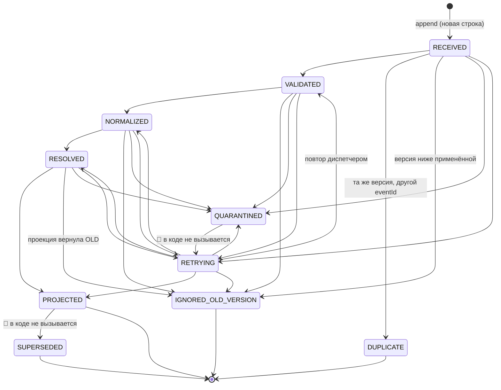
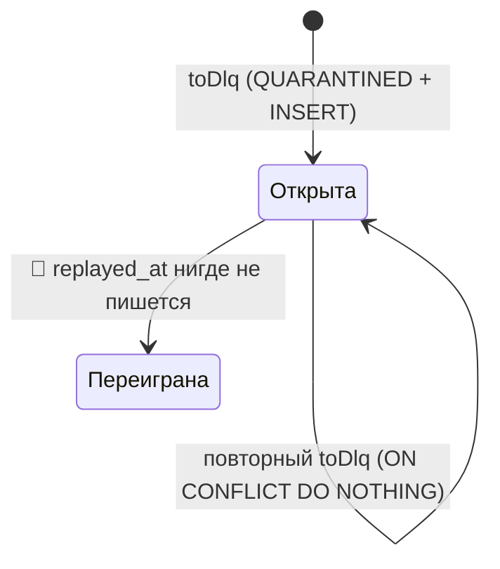
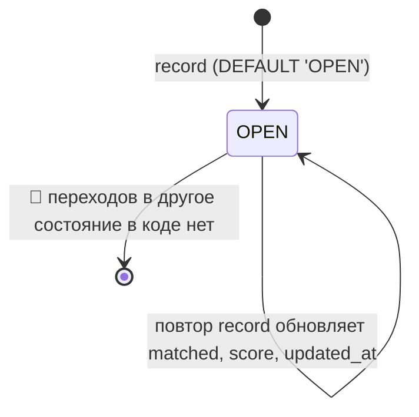
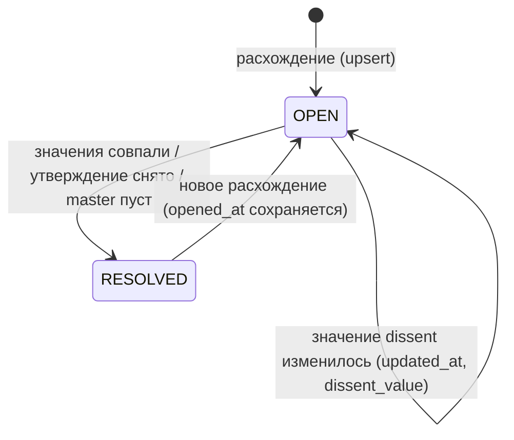
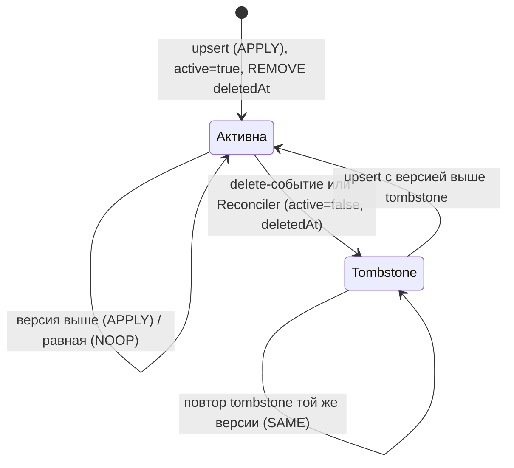
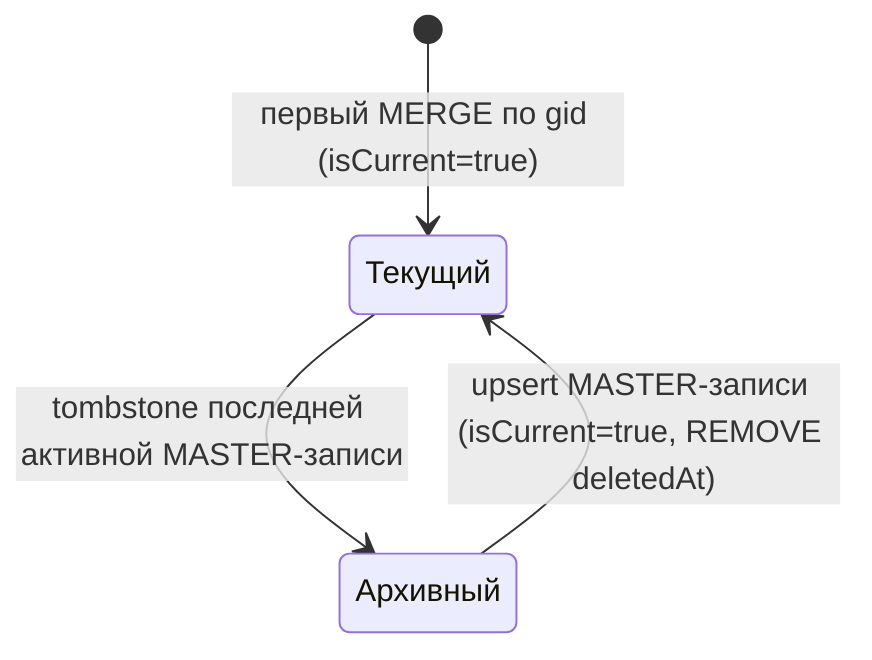
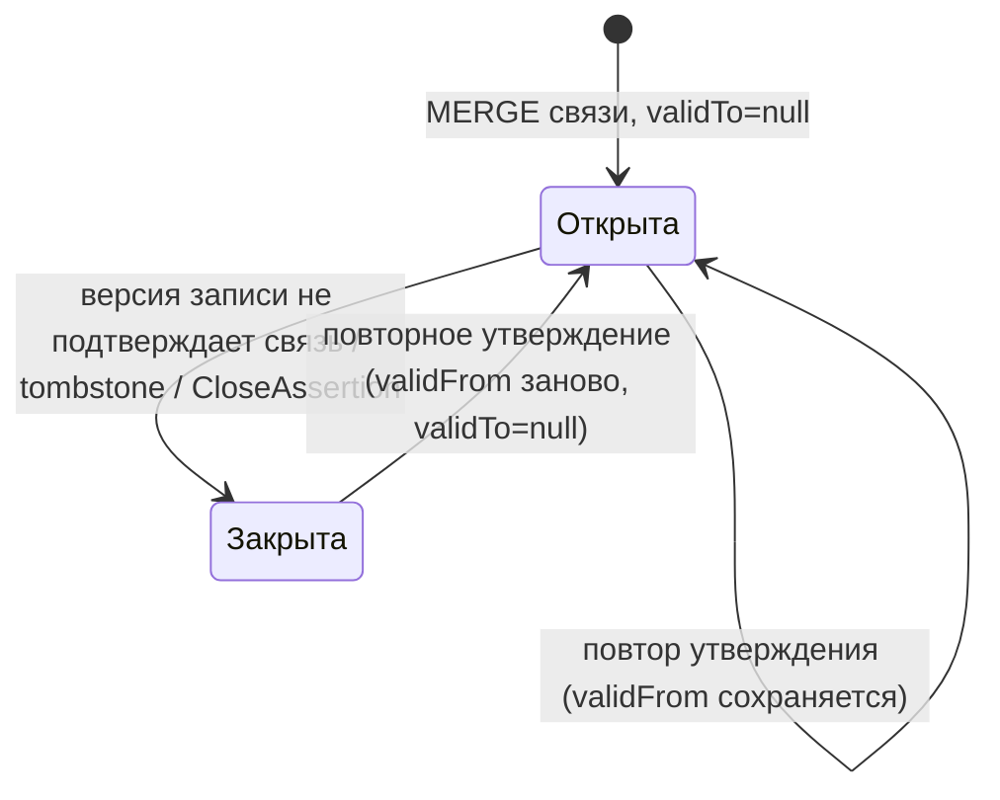
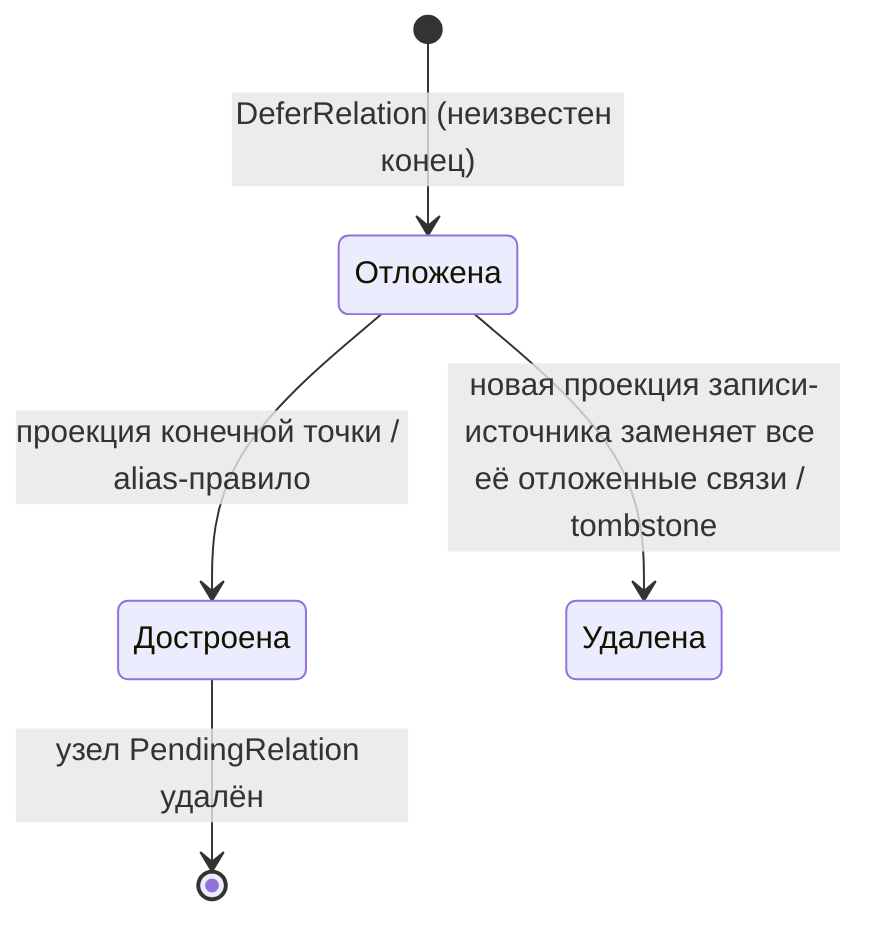
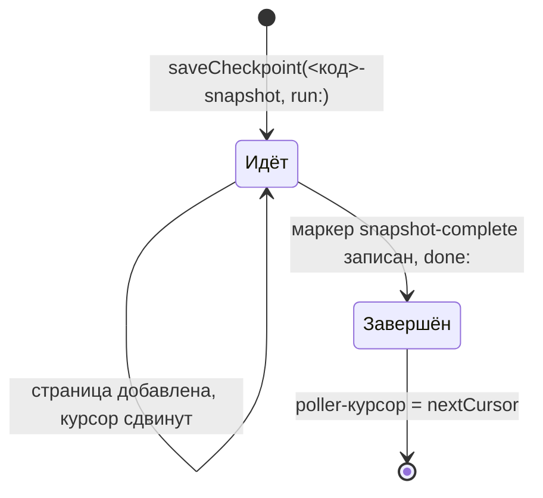
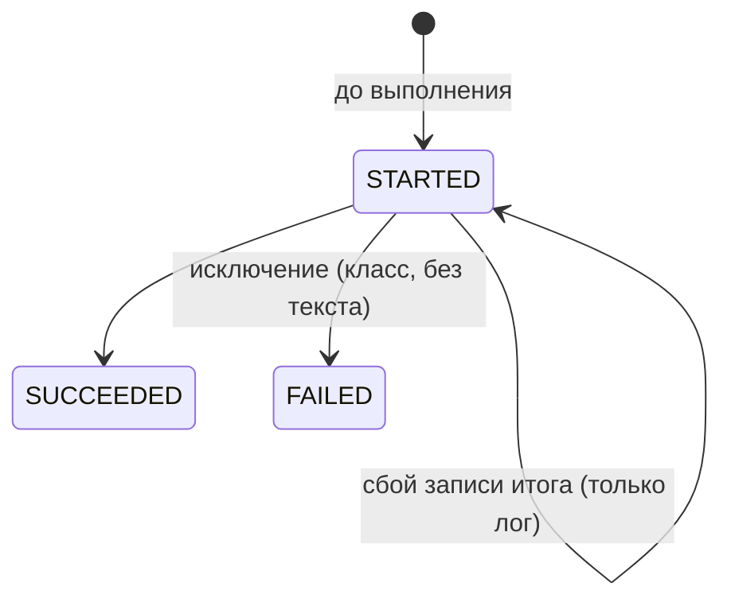

# Машины состояний

> Detective, этап R.4 (UNLOCKER-269). Источник — код ветки `epic/UNLOCKER-260` (после R.3, merge `3de34b7`). Диаграммы показывают только то, что код делает, а не то, что обещают `docs/00-vision.md` и `docs/02-data-model.md`. Расхождения помечены 🔴 и собраны в [`detective-gaps.md`](detective-gaps.md). Шкала: 🟢 прочитано в коде · 🟡 выведено · 🔴 пробел или расхождение. Сквозные правила — [`domain.md`](domain.md), права — [`permissions.md`](permissions.md).

Сводка автоматов:

| № | Сущность | Где хранится | Значения | Кто переводит |
|---|---|---|---|---|
| 1 | Событие журнала | `inbox_event.status` | 10 значений `ProcessingStatus` | `EventProcessor`, `JournalDispatcher`, `Reconciler` |
| 2 | Запись DLQ | `dlq_entry` (+ `replayed_at`) | «открыта» / «переиграна» | `PostgresEventJournal.toDlq`; закрытия нет 🔴 |
| 3 | Кандидат на совпадение | `identity_candidate.status` | `OPEN` | только значение по умолчанию 🔴 |
| 4 | Конфликт источников | `source_conflict.status` | `OPEN`, `RESOLVED` | `PostgresSourceConflicts` |
| 5 | Запись источника | `SourceRecord.active` | активна / tombstone | `GraphProjector` |
| 6 | Канонический узел | `isCurrent`, `deletedAt` | текущий / архивный | `GraphProjector` |
| 7 | Темпоральная связь | `validFrom`, `validTo` | открыта / закрыта | `GraphProjector` |
| 8 | Отложенная связь | узел `PendingRelation` | отложена / достроена | `GraphProjector`, `PendingRelations` |
| 9 | Прогон snapshot | checkpoint `<код>-snapshot` | `run:<id>` / `done:<id>` | `Poller` |
| 10 | Прогон `SyncRun` в графе | `SyncRun.status` | только `RUNNING` | 🔴 дальше не переходит |
| 11 | Админская операция | `admin_audit.status` | `STARTED`, `SUCCEEDED`, `FAILED` | `AdminOperations` |

---

## 1. Событие журнала (`inbox_event.status`)

### 1.1. Таблица переходов

Переходы проверяет `ProcessingStatus.canTransitionTo` (`contracts/event-schemas/src/main/java/io/github/unlocker/archrag/eventschemas/ProcessingStatus.java:26-41`) под блокировкой строки `SELECT ... FOR UPDATE` (`ingestion/event-journal/src/main/java/io/github/unlocker/archrag/eventjournal/PostgresEventJournal.java:323-338`). Недопустимый переход — `IllegalStateException` (`PostgresEventJournal.java:335-337`); на уровне БД его не держит ни CHECK, ни enum (`_reversa_sdd/database/business-rules.md`, §3) 🟢.

| Из | Допустимые в |
|---|---|
| `RECEIVED` | `VALIDATED`, `RETRYING`, `QUARANTINED`, `DUPLICATE`, `IGNORED_OLD_VERSION` |
| `VALIDATED` | `NORMALIZED`, `RETRYING`, `QUARANTINED`, `IGNORED_OLD_VERSION` |
| `NORMALIZED` | `RESOLVED`, `RETRYING`, `QUARANTINED`, `IGNORED_OLD_VERSION` |
| `RESOLVED` | `PROJECTED`, `RETRYING`, `QUARANTINED`, `IGNORED_OLD_VERSION` |
| `RETRYING` | `VALIDATED`, `NORMALIZED`, `RESOLVED`, `PROJECTED`, `QUARANTINED`, `IGNORED_OLD_VERSION` |
| `QUARANTINED` | только `RETRYING` |
| `PROJECTED` | только `SUPERSEDED` |
| `SUPERSEDED`, `DUPLICATE`, `IGNORED_OLD_VERSION` | никуда |

Переход в себя разрешён всегда (`ProcessingStatus.java:27-29`). Каждый переход в `RETRYING` увеличивает `attempts` (`PostgresEventJournal.java:345`).

### 1.2. Кто и по какому условию переводит (🟢)

| Переход | Условие | Код |
|---|---|---|
| `RECEIVED` (создание) | `append` с `ON CONFLICT (source, event_id) DO NOTHING`; повтор возвращает `DUPLICATE` как исход `append`, строки не создаёт | `ingestion/event-journal/src/main/java/io/github/unlocker/archrag/eventjournal/PostgresEventJournal.java:56-59` |
| → `VALIDATED` → `NORMALIZED` → `RESOLVED` | по одному шагу; `advance` не откатывает назад, кроме выхода из `RETRYING` | `ingestion/graph-projector/src/main/java/io/github/unlocker/archrag/graphprojector/EventProcessor.java:603-610` |
| `RECEIVED` → `DUPLICATE` | `VersionDecision.SAME`: версия равна применённой для того же `(source, sourceType, sourceId)` | `EventProcessor.java:303-322`, `ingestion/graph-projector/src/main/java/io/github/unlocker/archrag/graphprojector/VersionDecision.java:20-26` |
| `RECEIVED` → `IGNORED_OLD_VERSION` | `VersionDecision.OLD`: версия ниже применённой | `EventProcessor.java:303-322` |
| `RETRYING`/промежуточный → `IGNORED_OLD_VERSION` | повтор пережил более новую версию; проверка до записи в PostgreSQL | `EventProcessor.java:324-344` |
| `RESOLVED` → `IGNORED_OLD_VERSION` | проекция внутри транзакции Neo4j вернула `IGNORED_OLD_VERSION` (гонка двух событий одного объекта) | `EventProcessor.java:383-387`, `ingestion/graph-projector/src/main/java/io/github/unlocker/archrag/graphprojector/GraphProjector.java:312-324` |
| `RESOLVED` → `PROJECTED` | проекция применена или вернула `NOOP_SAME_VERSION`; затем сдвигается checkpoint `projector` | `EventProcessor.java:383-387, 612-617` |
| любое → `RETRYING` | временный отказ: `ProjectionException` (в т. ч. `UNRESOLVED_ENDPOINT`), `IDENTITY_CANDIDATE_FAILED`, `SOURCE_CONFLICT_FAILED`, `GRAPH_UNAVAILABLE` (`TransientException`, `ServiceUnavailableException`, `SessionExpiredException`), `GRAPH_CLIENT_ERROR`, `GRAPH_ERROR`, `RECONCILIATION_TRIGGER_FAILED` | `EventProcessor.java:228-236, 247-249, 297, 359-373, 619-622` |
| любое → `QUARANTINED` | отказ по самому событию: `UNKNOWN_SOURCE`, `UNSUPPORTED_EVENT_TYPE`, `UNKNOWN_SCHEMA_VERSION`, коды `NormalizationException`, `INVALID_PAYLOAD`, `INVALID_COMMANDS`, `GRAPH_REJECTED` (`Neo.ClientError.Statement.*`/`Request.*`) | `EventProcessor.java:193-198, 203-205, 259-261, 361-362, 365-370, 624-627`, `ingestion/normalizer/src/main/java/io/github/unlocker/archrag/normalizer/Normalizer.java:56-83` |
| `RECEIVED` → `QUARANTINED` из диспетчера | `NO_RAW_PAYLOAD`, `INVALID_RAW_PAYLOAD`, `MARKER_NO_RAW`: до `process` такие строки не доходят | `ingestion/ingestion-service/src/main/java/io/github/unlocker/archrag/ingestionservice/JournalDispatcher.java:139-153, 165-167` |

### 1.3. Выборка диспетчера

- В обработку берутся `RECEIVED` и (`RETRYING`, `VALIDATED`, `NORMALIZED`, `RESOLVED`, не менявшиеся дольше `retryDelay`) (`PostgresEventJournal.java:213-216`; `JournalDispatcher.java:26-28`) 🟢.
- Порядок `(receivedAt, source, eventId)`; если событие объекта ушло в `RETRYING` или бросило исключение, более поздние события этого же объекта в том же проходе пропускаются (`JournalDispatcher.java:111-121`) 🟢. Это сохраняет порядок версий внутри объекта.
- Конечные статусы и `QUARANTINED` входят в `FINISHED`: повторный `process` возвращает текущий статус, ничего не меняя (`EventProcessor.java:99-105, 190-192`) 🟢.
- Страница обрабатывается под `AdminLock`; занятый замок завершает проход (`JournalDispatcher.java:100-103`) 🟢.

### 1.4. Особые строки журнала (🟢)

| Строка | Как создаётся | Особенность |
|---|---|---|
| `replay:<replayId>:<исходный eventId>` | `ReplayService.replayOne`: новая строка с теми же `payloadRef`, `syncRunId`, `correlationId`; проходит весь конвейер | исходные строки не меняются; маркеры `snapshot-complete` пропускаются (`SKIPPED_SNAPSHOT_MARKER`); без raw — `SKIPPED_NO_RAW` (`ingestion/ingestion-service/src/main/java/io/github/unlocker/archrag/ingestionservice/ReplayService.java:35-36, 78-100`) |
| `reconcile:<syncRunId>:<sourceType>/<sourceId>` | `Reconciler.journalTombstone`: tombstone пишется в журнал до записи в граф | повтор доводит незавершённую строку до конечного статуса (`ingestion/graph-projector/src/main/java/io/github/unlocker/archrag/graphprojector/Reconciler.java:156-194`) |
| `snapshot-complete:<syncRunId>` | `Poller` после полного snapshot | не проецируется: `RESOLVED` → `reconciliation.snapshotComplete` → `PROJECTED` (`EventProcessor.java:289-300`) |

### 1.5. Пробелы автомата (🔴)

- 🔴 **`SUPERSEDED` недостижим.** Кроме определения в enum и перечня в `FINISHED`, значение встречается лишь в списке статусов консоли (`access/admin-console/src/main/java/io/github/unlocker/archrag/adminconsole/pg/SyncSources.java:31`). Ни `EventProcessor`, ни `Reconciler`, ни `JournalDispatcher` в него не переводят. `docs/00-vision.md:385` и `docs/02-data-model.md:250` описывают переход `PROJECTED → SUPERSEDED`; смысл «вытеснено новой версией» вместо этого реализован через `IGNORED_OLD_VERSION` для самого *старого* события и вообще не помечает ранее спроецированную строку.
- 🔴 **Выхода из `QUARANTINED` нет.** `canTransitionTo` разрешает `QUARANTINED → RETRYING` (`ProcessingStatus.java:38`), `docs/02-data-model.md:241` называет это «решением оператора», но админский REST (`AdminController.java:61-123`) не содержит операции возврата из карантина, а `JournalDispatcher` карантин не выбирает (`PostgresEventJournal.java:213-216`). Практически карантин терминален; «починка» — только `replay`, который создаёт *новую* строку `replay:*`, а карантинная строка остаётся (связано с R.3, `_reversa_sdd/database/data-dictionary.md:94`).
- 🔴 **`RETRYING` без предела попыток.** `attempts` растёт, но порога перевода в `QUARANTINED` по числу попыток нет (`PostgresEventJournal.java:345`; `JournalDispatcher.java:111-121`). Событие с постоянным сбоем `GRAPH_CLIENT_ERROR` (не `Statement`/`Request`) будет повторяться бесконечно 🟡.
- 🟡 Строка `DUPLICATE` из `append` (повтор `eventId`) и статус `DUPLICATE` (повтор версии при другом `eventId`) — разные вещи с одним именем: первый возвращается вызывающему как исход вставки и в БД не пишется, второй сохраняется в `inbox_event.status`.

---

## 2. Запись DLQ (`dlq_entry`)

- `toDlq` в одной транзакции переводит событие в `QUARANTINED` и вставляет строку; конфликт по частичному индексу `uq_dlq_entry_open (source, event_id) WHERE replayed_at IS NULL` молча пропускается (`PostgresEventJournal.java:132-160`; `ingestion/event-journal/src/main/resources/db/migration/V1__event_journal.sql:48`) 🟢.
- Инвариант «не больше одной необработанной записи на событие» защищает от дубля при повторном карантине (повторный `toDlq` из `QUARANTINED` возможен: `ProcessingStatus.java:27-29` разрешает переход в себя, `PostgresEventJournal.java:139` не проверяет текущий статус, `EventJournalIT.repeatedDlqKeepsSingleRecord:187-196` вызывает `toDlq` дважды подряд; `uq_dlq_entry_open` и `ON CONFLICT` защищают от последовательного дубля, при этом `error_code`/`error_reason` в `inbox_event` перезаписываются, а `dlq_entry` хранит первые значения) 🟢 `[Ревью R.7]`.
- 🔴 `replayed_at` читается (`access/admin-console/src/main/java/io/github/unlocker/archrag/adminconsole/pg/ConsoleReadRepository.java:158`; `ingestion/ingestion-service/src/main/java/io/github/unlocker/archrag/ingestionservice/IngestionMetrics.java:71`), но не пишется: `UPDATE dlq_entry` в репозитории нет. Метрика «открытых записей DLQ» поэтому никогда не уменьшается после `replay` (ответ на вопрос R.3, `_reversa_sdd/database/data-dictionary.md:187-193`: это недоделка, ADR на такой выбор нет) 🔴.

---

## 3. Кандидат на совпадение (`identity_candidate.status`)

- Создание: `INSERT ... ON CONFLICT (...) DO UPDATE SET matched, score, updated_at`; `status` и `first_seen_at` при повторе не трогаются (`ingestion/identity-resolution/src/main/java/io/github/unlocker/archrag/identityresolution/PostgresIdentityCandidates.java:54-61`) 🟢.
- Поле `IdentityCandidate.status` — просто `String` (`ingestion/identity-resolution/src/main/java/io/github/unlocker/archrag/identityresolution/IdentityCandidate.java:14-22`), перечисления значений нет 🟢.
- Кандидат не исчезает, когда признаки перестали совпадать: `forget` удаляет `identity_feature` записи, но не `identity_candidate` (`PostgresIdentityCandidates.java:105-120`) 🟡.
- Кандидат не приводит к объединению: единственный путь к общему `gid` — approved crosswalk, который оператор загружает вручную (`CrosswalkService.java:35-64`), причём обратной связи «crosswalk подтвердил кандидата» нет, статус остаётся `OPEN` 🔴.
- 🔴 `APPROVED`/`REJECTED`/`MERGED` в коде не определены; жизненный цикл кандидата не завершён (вопрос R.3 о нём остаётся открытым: решения владельца в `docs/adr/` нет, ADR 0019 говорит только «кандидаты порождают лишь запись»).

---

## 4. Конфликт источников (`source_conflict.status`)

- Значения: `OPEN`, `RESOLVED`; вид — `PROPERTY` или `RELATION` (`ingestion/identity-resolution/src/main/java/io/github/unlocker/archrag/identityresolution/SourceConflict.java:38-47`) 🟢.
- Открытие/повторное открытие: `INSERT ... ON CONFLICT ... DO UPDATE SET status='OPEN', resolved_at=NULL`, `opened_at` сохраняется (`ingestion/identity-resolution/src/main/java/io/github/unlocker/archrag/identityresolution/PostgresSourceConflicts.java:48-58`) 🟢.
- Закрытие: `UPDATE ... SET status='RESOLVED'` (`PostgresSourceConflicts.java:61-67`) в случаях: значения сравнялись; запись сняла утверждение (`retract`); у `RELATION` пуст `master`; запись пришла без свойства/связи (`SourceConflicts.java:30-54`) 🟢.
- Строка никогда не удаляется (ADR 0020 по духу; прямой нормы про `source_conflict` в ADR нет) 🟢.
- Условие конфликта: у свойства есть утверждение авторитетной записи и утверждение неавторитетной с другим значением (точное сравнение строк) (`PostgresSourceConflicts.java:44-47`; Javadoc `SourceConflicts.java:10-18`) 🟢. Значение узла от конфликта не зависит: пишет только авторитетный источник (`GraphProjector.java:422-432`).
- Вручную конфликт не закрывается: ни в консоли (только `GET`), ни в admin REST операции «resolve» нет; `MANUAL` в `AuthorityMatrix` никогда не авторитетен, ручное решение отложено «на E3» (`contracts/canonical-model/src/main/java/io/github/unlocker/archrag/canonicalmodel/authority/AuthorityMatrix.java:14-22`). Видение предусматривает ручное решение как отдельное утверждение (`docs/00-vision.md:399`), `docs/02-data-model.md:360` прямо пишет «ручных решений нет»: это документированная отложенная работа 🟡, не расхождение.
- 🟡 Конфликты `RELATION` не обновляют маркер `ASSERTS.conflicts`, если проверка вызвана событием второй стороны (ограничения 1 в ADR 0030 и 0031): `source_conflict` обновляется сразу, граф — со следующим событием.

---

## 5. Запись источника (`SourceRecord.active`) и tombstone

- Upsert: `active=true`, `REMOVE r.deletedAt`, версия и `contentHash` обновляются (`ingestion/graph-projector/src/main/java/io/github/unlocker/archrag/graphprojector/GraphProjector.java:447-450`) 🟢.
- Tombstone: `active=false`, `deletedAt`, `sourceVersion` (`GraphProjector.java:507-518`) 🟢.
- Решение по версии: upsert — `APPLY` при `incoming > applied`, `SAME` при равенстве, `OLD` ниже; tombstone — те же правила, но при равной версии применяется к ещё активной записи (`VersionDecision.java:20-38`) 🟢. Версии сравниваются как `BigInteger` (`contracts/event-schemas/src/main/java/io/github/unlocker/archrag/eventschemas/SourceVersion.java:12-21`) 🟢.
- Конкурентные проекции одного объекта сериализует `MERGE ... SET r._lock = true REMOVE r._lock` в начале транзакции (`GraphProjector.java:304-310`) 🟢.
- 🟡 Версия tombstone `Reconciler` берётся из уже применённой записи (`Reconciler.java:130-135`), поэтому upsert с той же версией после reconcile-tombstone вернёт `SAME`/`DUPLICATE`, а не воскресит запись; воскресить её может только версия выше (источник вернул объект и увеличил версию).

---

## 6. Канонический узел: текущий/архивный

- Узел архивируется (`isCurrent=false`, `deletedAt = coalesce(deletedAt, $at)`) только если **нет другой активной записи с ребром `ASSERTS {authority: 'MASTER'}`** (`GraphProjector.java:543-548`) 🟢. SUPPLEMENTARY-запись узел не держит живым.
- Воскрешение — только upsert записи-мастера: `FOREACH ($master) SET n.isCurrent = true REMOVE n.deletedAt` (`GraphProjector.java:460`); upsert SUPPLEMENTARY-записи узел не воскрешает 🟢.
- Физического удаления узлов нет (`GraphProjector.java:50-51`) 🟢.
- 🟡 Если первой пришла SUPPLEMENTARY-запись, узел создаётся (`MERGE (n:Root {gid})`, `ON CREATE SET n.isCurrent = true`) с пустым набором свойств, потому что неавторитетные свойства пропускаются (`GraphProjector.java:422-432, 453-455`): до прихода мастера в графе виден «пустой» текущий узел.

---

## 7. Темпоральная связь (`validFrom`/`validTo`)

- 10 типов связей из 15 помечены `temporal = true`; не темпоральны `PART_OF`, `HOSTED_ON` и служебные `ASSERTS`, `OWNS_RECORD`, `PROCESSED` (`contracts/canonical-model/src/main/java/io/github/unlocker/archrag/canonicalmodel/relation/RelationType.java:13-27`) 🟢. Структурные `HAS_DEPLOYMENT`, `IN_ENVIRONMENT`, `DECOMPOSED_INTO`, `IMPLEMENTED_IN` стали темпоральными по ADR 0028.
- Открытие: `validFrom` из источника, иначе время события; повторное утверждение закрытой связи открывает её заново (`GraphProjector.java:567-575, 586-589`) 🟢.
- Замещение: после применения версии открытая связь *типа, который версия утверждает или откладывает*, от этой записи, но отсутствующая в версии, получает `validTo = max(validFrom, eventTime)` (`GraphProjector.java:611-645`); типы, которых в версии нет, не трогаются; tombstone и повтор версии ничего не замещают (`GraphProjector.java:350-352`) 🟢.
- Идентичность связи — тройка `(from, to, identityProps)`; сейчас единственное идентифицирующее свойство — `DEPLOYED_FROM.commit` (`RelationType.java:20`), смена commit закрывает старое ребро и открывает новое (ADR 0029) 🟢.
- Tombstone записи закрывает все открытые темпоральные рёбра, исходящие от/входящие в узлы, которые она утверждает, и рёбра, где она сама `assertedBy` (`GraphProjector.java:519-541`) 🟢.
- 🟡 `PART_OF` и `HOSTED_ON` не закрываются никогда: у них нет `validTo`, а запросы читают их без фильтра времени (коммит `95594a6`: «убрать validTo с HOSTED_ON»).
- 🟡 Запись `PARTIAL` (`_completeness`) нормализатором и проектором не учитывается: единственный потребитель ключа — `StoredEventReader` (воспроизведение из журнала) (`ingestion/ingestion-service/src/main/java/io/github/unlocker/archrag/ingestionservice/StoredEventReader.java:33, 75`). Поэтому `PARTIAL`-запись с неполным списком однотипных связей закроет остальные связи того же типа. Для «пропущенного типа целиком» защита работает (тип не утверждён — не трогается).

---

## 8. Отложенная связь (`PendingRelation`)

- Нормализатор не создаёт фиктивных узлов: неизвестная цель → `UnresolvedReference`; `EventProcessor` превращает их в `DeferRelation` (один раз на связь с двумя неизвестными концами) (`EventProcessor.java:221-223`; `ingestion/normalizer/src/main/java/io/github/unlocker/archrag/normalizer/CommandSink.java:62-68, 90-101`) 🟢.
- Проектор сохраняет узел `PendingRelation` (ключ constraint `PendingRelation.key`) и достраивает связь в транзакции проекции конечной точки, обычным `upsertRelation` с проверкой authority и темпоральностью (`GraphProjector.java:327-337, 362-415`) 🟢.
- При каждой применённой проекции записи её отложенные связи заменяются целиком (`GraphProjector.java:327-328`); tombstone их удаляет (`GraphProjector.java:62-64`) 🟢.
- Alias-ключи: `SourceKey(SCM, REPOSITORY_URL, url)` достраивается записью SCM `REPOSITORY` с тем же `url`; `SourceKey(EAM, IT_SYSTEM_CODE, code)` — записью EAM `IT_SYSTEM` с тем же `eamCode` (`GraphProjector.java:92-95`) 🟢.
- Reconciliation отложенные связи не лечит (`EventProcessor.java:77-79`). Допущение: диспетчер однопоточный, экземпляр один, поэтому повторной проверки после записи отложенной связи нет (`GraphProjector.java:65-67`) 🟡 (риск при втором экземпляре, см. gap list production).
- Срока годности отложенной связи нет: связь с концом, который никогда не придёт, висит вечно 🟡.

---

## 9. Прогон snapshot у адаптера (checkpoint)

- Курсор `<код>-poller` сдвигается только после успешного `append` всей страницы (`adapters/adapter-core/src/main/java/io/github/unlocker/archrag/adaptercore/Poller.java:22-25, 136`); пустой checkpoint означает полный snapshot (`Poller.java:93-94`) 🟢.
- Прерванный snapshot продолжается под тем же `syncRunId` (`run:<id>`); маркер ставится только после последней страницы и подтверждения источника `snapshotComplete` (`Poller.java:147-171, 180-186`); если источник закончил без `snapshot-complete`, бросается `IllegalStateException` (`Poller.java:164-167`) 🟢.
- Удаления выполняются *отдельно*, в проекторе: `Reconciler` берёт множество объектов прогона из журнала и сверяет `objectCount` маркера; меньше событий, чем заявлено, — `IllegalStateException`, ничего не удаляется (`Reconciler.java:105-108`) 🟢. Удаление на середине загрузки невозможно: без маркера `snapshot-complete` missing set не считается.

---

## 10. `SyncRun` в графе

- `SyncRunStatus` определяет `RUNNING`, `SUCCEEDED`, `FAILED` (`contracts/canonical-model/src/main/java/io/github/unlocker/archrag/canonicalmodel/provenance/SyncRunStatus.java:4-6`), но проектор создаёт узел с `status = 'RUNNING'` (`GraphProjector.java:695-700`) и никогда не меняет его: ни `endedAt`, ни `SUCCEEDED`/`FAILED` не пишутся 🔴. Счётчики умышленно не ведутся (инкремент в повторяемой транзакции удваивался бы, `GraphProjector.java:694`).
- Следствие: «успешный/упавший прогон» из графа узнать нельзя; рабочий источник правды о прогоне — журнал (`syncRunId`) и checkpoint `<код>-snapshot`.

---

## 11. Админская операция (`admin_audit.status`)

- Запись `STARTED` обязательна до операции: нет аудита — нет операции (`AdminOperations.java:13-14, 45-47`) 🟢. Параллельно идёт одна операция (`AdminLock`, `AdminBusyException` → HTTP 409) (`AdminController.java:135-138`) 🟢.
- `crosswalk` ведёт аудит *по элементам* через `locked` (`AdminOperations.java:71-76`; `CrosswalkService.java:43-64`): `APPLIED` → `SUCCEEDED`; `CONFLICT`/`INVALID` → `FAILED` с `status` в `result` 🟢.
- 🟡 Сбой записи итога после успешной операции оставляет `STARTED` навсегда (`AdminOperations.java:56-58, 63-69`); процесс, убитый посреди операции, также оставляет `STARTED`. Автоматического «закрытия зависших» нет.
