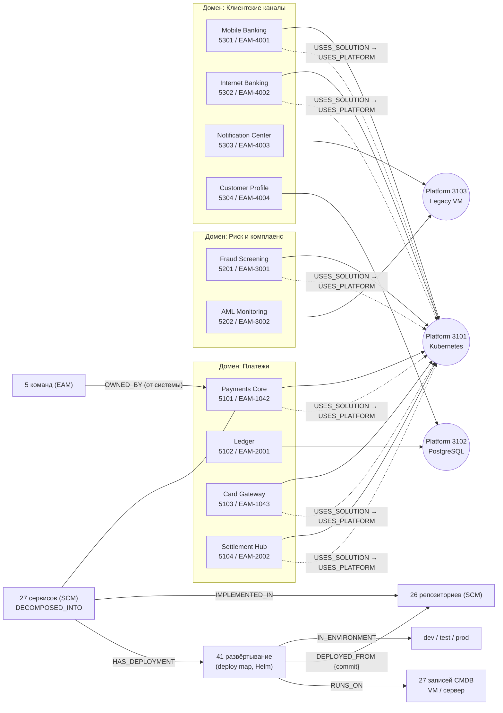

# Демо-набор данных Arch RAG

> Спецификация набора, из которого генерируется профиль заглушек `ARCHRAG_STUB_PROFILE=demo` (`source-stubs`, `demo-launcher`; задача DEMO.2). Документ описывает **что** лежит в источниках; как это грузится и запускается, описывают `scenarios.md` и скрипты `platform/docker/demo/`. Все имена вымышленные. Опирается на реализованное в `develop`: [02-data-model](../02-data-model.md), [03-interfaces](../03-interfaces.md), [06-eam-integration](../06-eam-integration.md).

## 1. Принципы

- **Вымышленный банк «Nordhaven Bank»**, расширение нынешнего платёжного seed (`Payments Core`, `Ledger`, `Card Processing`). Записи нынешнего seed (`5101`, `5102`, `EAM-1042`, `EAM-2001`, `svc-payments-api`, `svc-ledger-api`, `repo-payments-api`, `vm-pay-01`, `dep-payments-api-prod`, `TEAM-PAY`) входят в демо с теми же ключами и значениями.
- **Масштаб:** 3 бизнес-домена, 10 ИТ-систем, 8 ИТ-решений, 3 платформы, 27 сервисов (26 действующих и один выводимый из эксплуатации), 26 репозиториев, 3 окружения, 27 записей CMDB (26 хостов и один дубль), 5 команд, 41 развёртывание.
- **Демо-набор — отдельный профиль.** Профиль по умолчанию и тестовые seed не меняются; на демо-наборе не держатся ни CI, ни приёмочные тесты.
- **Только то, что граф умеет строить сегодня.** Данные ложатся в существующие метки и связи. Чего в модели нет (домен как узел, `Namespace`, `KubernetesCluster`, `HOSTED_ON`, `OWNED_BY` у сервиса), в наборе не изображается; расхождения собраны в [разделе 8](#8-вопросы-архитектору-и-ограничения).
- **Воспроизводимость.** Значения, которые не перечислены явно (полные commit'ы), выводятся правилом из [раздела 4.2](#42-развёртывания-deploy-map--helm). Набор детерминирован: два запуска `seed.sh demo` дают один и тот же граф с точностью до `gid` и времён.
- **Время.** Времена записей задаёт поле `updatedAt` изменения источника (из него адаптер берёт время события, и по нему считается `lastSeenAt`). Базовое время seed — момент запуска; «устаревшие» записи получают смещение назад ([4.4](#44-cmdb-compute_instance)).

## 2. Обзор

Стрелки «система → решение → платформа» схематичны: у каждой системы `USES_SOLUTION` ведёт на своё решение, у решения `USES_PLATFORM` — на платформу ([4.1](#41-eam-платформы-решения-системы-команды)). Домен — не узел графа ([раздел 8](#8-вопросы-архитектору-и-ограничения)).

## 3. Домены, команды и их системы

| Домен | Система (EAM `id` / `eam_id`) | Решение | Платформа | Команда-владелец | Сервисов |
|---|---|---|---|---|---|
| Платежи | Payments Core (`5101` / `EAM-1042`) | Card Processing (`7201`) | Kubernetes (`3101`) | Payments Team (`TEAM-PAY`) | 4 |
| Платежи | Ledger (`5102` / `EAM-2001`) | Ledger Engine (`7202`) | PostgreSQL (`3102`) | Ledger & Settlement Team (`TEAM-LEDGER`) | 4 |
| Платежи | Card Gateway (`5103` / `EAM-1043`) | Card Processing (`7201`) | Kubernetes (`3101`) | Payments Team (`TEAM-PAY`) | 3 |
| Платежи | Settlement Hub (`5104` / `EAM-2002`) | Settlement Engine (`7203`) | Kubernetes (`3101`) | Ledger & Settlement Team (`TEAM-LEDGER`) | 3 |
| Риск и комплаенс | Fraud Screening (`5201` / `EAM-3001`) | Risk Decisioning (`7204`) | Kubernetes (`3101`) | Risk Team (`TEAM-RISK`) | 2 |
| Риск и комплаенс | AML Monitoring (`5202` / `EAM-3002`) | Compliance Suite (`7207`) | Legacy VM (`3103`) | Risk Team (`TEAM-RISK`) | 2 |
| Клиентские каналы | Mobile Banking (`5301` / `EAM-4001`) | Digital Channels Suite (`7205`) | Kubernetes (`3101`) | Digital Channels Team (`TEAM-DIGI`) | 2 |
| Клиентские каналы | Internet Banking (`5302` / `EAM-4002`) | Digital Channels Suite (`7205`) | Kubernetes (`3101`) | Digital Channels Team (`TEAM-DIGI`) | 2 |
| Клиентские каналы | Notification Center (`5303` / `EAM-4003`) | Messaging Hub (`7206`) | Kubernetes (`3101`) — **намеренное расхождение, кейс К-4б** | Platform Engineering (`TEAM-PLAT`) | 2 |
| Клиентские каналы | Customer Profile (`5304` / `EAM-4004`) | Customer Data Store (`7208`) | PostgreSQL (`3102`) | Platform Engineering (`TEAM-PLAT`) | 2 |

Колонка «Сервисов» считает сервисы, привязанные к системе, включая выводимый `svc-legacy-statements` (Ledger). 27-й сервис, `svc-partner-gateway`, не привязан ни к одной системе (кейс К-8). Точный перечень — в [4.3](#43-scm-сервисы-и-репозитории). Платформа системы в таблице — это `platform_id` её записи EAM; он обязан совпадать с `platform_id` решения ([ADR 0031](../adr/0031-it-system-platform-invariant.md)).

## 4. Данные по источникам

### 4.1. EAM: платформы, решения, системы, команды

Заглушка EAM API (`/api/<тип>/`, ключ — целочисленный `id`); `TEAM` и `SERVICE_DEPENDENCY` отдаёт плоская заглушка EAM (как в нынешнем seed, [03 §5.5](../03-interfaces.md#55-заглушки-мастер-систем)).

**Платформы** (`platforms`, `Platform`)

| `id` | name | lifecycle |
|---|---|---|
| `3101` | Kubernetes Platform | PRODUCTION |
| `3102` | PostgreSQL Platform | PRODUCTION |
| `3103` | Legacy VM Platform | SUNSET |

**Решения** (`itproducts`, `Solution`)

| `id` | name | `platform_id` | Домен (в `description`) |
|---|---|---|---|
| `7201` | Card Processing | `3101` | Payments |
| `7202` | Ledger Engine | `3102` | Payments |
| `7203` | Settlement Engine | `3101` | Payments |
| `7204` | Risk Decisioning | `3101` | Risk & Compliance |
| `7205` | Digital Channels Suite | `3101` | Customer Channels |
| `7206` | Messaging Hub | `3103` | Customer Channels |
| `7207` | Compliance Suite | `3103` | Risk & Compliance |
| `7208` | Customer Data Store | `3102` | Customer Channels |

**ИТ-системы** (`itsystems`, `ITSystem`)

| `id` (sourceId) | `eam_id` (`systemCode` в SCM) | name | `product_id` | `platform_id` | `criticality` | `ownerTeam` |
|---|---|---|---|---|---|---|
| `5101` | `EAM-1042` | Payments Core | `7201` | `3101` | HIGH | `TEAM-PAY` |
| `5102` | `EAM-2001` | Ledger | `7202` | `3102` | HIGH | `TEAM-LEDGER` |
| `5103` | `EAM-1043` | Card Gateway | `7201` | `3101` | HIGH | `TEAM-PAY` |
| `5104` | `EAM-2002` | Settlement Hub | `7203` | `3101` | MEDIUM | `TEAM-LEDGER` |
| `5201` | `EAM-3001` | Fraud Screening | `7204` | `3101` | `CRITICAL` (вне словаря, **кейс К-10**) | `TEAM-RISK` |
| `5202` | `EAM-3002` | AML Monitoring | `7207` | `3103` | MEDIUM | `TEAM-RISK` |
| `5301` | `EAM-4001` | Mobile Banking | `7205` | `3101` | HIGH | `TEAM-DIGI` |
| `5302` | `EAM-4002` | Internet Banking | `7205` | `3101` | MEDIUM | `TEAM-DIGI` |
| `5303` | `EAM-4003` | Notification Center | `7206` | **`3101`** (у решения `3103`, **кейс К-4б**) | LOW | `TEAM-PLAT` |
| `5304` | `EAM-4004` | Customer Profile | `7208` | `3102` | HIGH | `TEAM-PLAT` |

`description` каждой системы и решения начинается со слов `Domain: <Payments | Risk & Compliance | Customer Channels>.`, чтобы домен находился полнотекстовым поиском `asset_text` (по `ITSystem` и `Service`).

**Команды** (`TEAM`, `Team`)

| sourceId | name | type |
|---|---|---|
| `TEAM-PAY` | Payments Team | PRODUCT |
| `TEAM-LEDGER` | Ledger & Settlement Team | PRODUCT |
| `TEAM-RISK` | Risk Team | PRODUCT |
| `TEAM-DIGI` | Digital Channels Team | PRODUCT |
| `TEAM-PLAT` | Platform Engineering | PLATFORM |

**Зависимости сервисов** (`SERVICE_DEPENDENCY`, → `DEPENDS_ON {kind, protocol, criticality}`). Ключ — `dep-<from>-<to>` (без префикса `svc-`), `from`/`to` — ключи сервисов SCM. Все `kind=SYNC`, `protocol=HTTP`, если не указано иное.

| Откуда | Куда | Особенности |
|---|---|---|
| `svc-mobile-bff` | `svc-mobile-auth`, `svc-payments-api` (HIGH), `svc-customer-profile-api`, `svc-notification-gateway` (`ASYNC`, `AMQP`) | |
| `svc-ib-web` | `svc-ib-api` | |
| `svc-ib-api` | `svc-payments-api` (HIGH), `svc-customer-profile-api` | |
| `svc-payments-api` | `svc-payments-router` (HIGH), `svc-ledger-api` (HIGH, нынешний seed), `svc-aml-screening` | |
| `svc-payments-orchestrator` | `svc-payments-router` | |
| `svc-payments-batch` | `svc-ledger-posting` | |
| `svc-payments-router` | `svc-card-gateway` (HIGH), `svc-fx-rates` | |
| `svc-card-gateway` | `svc-card-authorizer` (HIGH) | |
| `svc-card-authorizer` | `svc-fraud-scoring` (HIGH), `svc-card-tokenizer` | |
| `svc-fraud-scoring` | `svc-fraud-rules` (HIGH), `svc-customer-profile-api` | |
| `svc-ledger-api` | `svc-ledger-posting` (HIGH) | |
| `svc-ledger-reporting` | `svc-ledger-posting` | |
| `svc-settlement-engine` | `svc-ledger-posting`, `svc-card-gateway` | |
| `svc-settlement-recon` | `svc-settlement-engine` | |
| `svc-aml-case-mgmt` | `svc-aml-screening` | |
| `svc-aml-screening` | `svc-customer-profile-api` | |
| `svc-customer-consent` | `svc-customer-profile-api` | |
| `svc-notification-gateway` | `svc-sms-dispatcher` (`ASYNC`) | |
| `svc-legacy-statements` | `svc-ledger-reporting` | |

Всего 29 рёбер `DEPENDS_ON`. Самая длинная цепочка: `ib-web → ib-api → payments-api → payments-router → card-gateway → card-authorizer → fraud-scoring → fraud-rules` (7 рёбер).

### 4.2. Развёртывания: deploy map / Helm

Формат `deploymap-poc-1` ([ADR 0029](../adr/0029-helm-chart-system-repo-commit.md)). **Окружения** (`ENVIRONMENT`, ключ — код):

| sourceId (`code`) | name | класс |
|---|---|---|
| `dev` | Development | DEV |
| `test` | Test | TEST |
| `prod` | Production | PROD |

**Правила записи `DEPLOYMENT`** (`dep-<сервис без svc->-<env>`):

- `chart` = имя сервиса, `chartVersion` = `version` развёртывания; `service` = ключ сервиса SCM; `hosts` = sourceId записей CMDB ([4.4](#44-cmdb-compute_instance)).
- Аннотации Helm: `archrag.io/eam-system-id` = `id` системы сервиса (не `eam_id`); `archrag.io/git-repo-url` = URL репозитория сервиса (в PROD в ssh-форме `git@git.example.org:<группа>/<репо>.git`, в TEST и DEV — `https://…`, нормализуется в один и тот же `url`); `archrag.io/git-commit` — 40 hex.
- **Правило commit'а:** `sha1(<репозиторий>@<chartVersion>)` в нижнем регистре, где `<репозиторий>` — имя репозитория без `repo-`. Исключения заданы явно: `payments-api` PROD `9fceb02d0ae598e95dc970b74767f19372d61af8` (нынешний seed), TEST `1b4f0e9851971998e732078544c96b36c3d01ced` (`StubSources.PAYMENTS_API_NEW_COMMIT`). Для `payments-api@1.5.0-rc1` правило даёт `1ffad2123042d3bb82f6140bd07eee2d37a7c311`.

**PROD** (27 развёртываний; commit'ы по правилу, кроме отмеченного):

| Развёртывание | `chartVersion` | `hosts` (CMDB) | Заметка |
|---|---|---|---|
| `dep-payments-api-prod` | 1.4.2 | `vm-pay-01`, `vm-pay-02` | нынешний seed; commit явный |
| `dep-payments-router-prod` | 2.3.0 | `vm-pay-01`, `vm-pay-02` | |
| `dep-payments-orchestrator-prod` | 0.9.4 | `vm-pay-03` | |
| `dep-payments-batch-prod` | 1.1.0 | `vm-pay-03` | |
| `dep-ledger-api-prod` | 3.2.1 | `vm-ledger-01`, `vm-ledger-02` | |
| `dep-ledger-posting-prod` | 3.2.1 | `vm-ledger-01`, `vm-ledger-02` | репозиторий-монорепо `repo-ledger` |
| `dep-ledger-reporting-prod` | 3.1.0 | `vm-legacy-app-01` | монорепо `repo-ledger`; общая ВМ |
| `dep-card-gateway-prod` | 4.0.2 | `vm-card-01`, `vm-card-02` | |
| `dep-card-authorizer-prod` | 4.0.2 | `vm-card-01`, `vm-card-02` | |
| `dep-card-tokenizer-prod` | 1.2.0 | `vm-card-02` | |
| `dep-settlement-engine-prod` | 2.0.0 | `vm-settle-01` | |
| `dep-settlement-recon-prod` | 1.3.5 | `vm-legacy-app-01` | общая ВМ; **`eam-system-id` = `5102`** вместо `5104` (**кейс К-9**) |
| `dep-fx-rates-prod` | 1.0.7 | `vm-settle-01` | |
| `dep-fraud-scoring-prod` | 5.1.0 | `vm-risk-01`, `vm-risk-02` | |
| `dep-fraud-rules-prod` | 5.1.0 | `vm-risk-02`, `vm-risk-03` | |
| `dep-aml-screening-prod` | 2.4.1 | `vm-risk-03` | |
| `dep-aml-case-mgmt-prod` | 1.8.0 | `vm-legacy-app-01` | общая ВМ |
| `dep-mobile-bff-prod` | 6.2.0 | `vm-chan-01`, `vm-chan-02` | |
| `dep-mobile-auth-prod` | 2.1.3 | `vm-chan-02` | |
| `dep-ib-web-prod` | 4.5.0 | `vm-chan-01` | |
| `dep-ib-api-prod` | 4.5.0 | `vm-chan-01`, `vm-chan-02` | |
| `dep-notification-gateway-prod` | 1.9.2 | `vm-legacy-app-01` | общая ВМ |
| `dep-sms-dispatcher-prod` | 1.2.4 | `vm-legacy-app-02` | |
| `dep-customer-profile-api-prod` | 3.0.1 | `vm-data-01` | |
| `dep-customer-consent-prod` | 1.4.0 | `vm-data-01`, `vm-chan-03` | |
| `dep-legacy-statements-prod` | 0.8.0 | `vm-legacy-app-02` | сервис исчезает из SCM (**кейс К-6**) |
| `dep-partner-gateway-prod` | 0.5.0 | `vm-chan-03` | репозитория нет в SCM (**кейс К-8**) |

**TEST** (10 развёртываний, версия обычно на патч выше PROD):

| Развёртывание | `chartVersion` | `hosts` |
|---|---|---|
| `dep-payments-api-test` | 1.4.3 | `vm-pay-test-01` (commit явный: `1b4f0e98…`) |
| `dep-payments-router-test` | 2.3.1 | `vm-pay-test-01` |
| `dep-card-gateway-test` | 4.0.3 | `vm-card-test-01` |
| `dep-card-authorizer-test` | 4.0.3 | `vm-card-test-01` |
| `dep-ledger-api-test` | 3.2.2 | `vm-ledger-test-01` |
| `dep-ledger-posting-test` | 3.2.2 | `vm-ledger-test-01` |
| `dep-settlement-engine-test` | 2.0.1 | `vm-ledger-test-01` |
| `dep-fraud-scoring-test` | 5.2.0-rc1 | `vm-risk-test-01` |
| `dep-mobile-bff-test` | 6.3.0-rc1 | `vm-chan-test-01` |
| `dep-ib-api-test` | 4.5.1 | `vm-chan-test-01` |

**DEV** (4 развёртывания):

| Развёртывание | `chartVersion` | `hosts` | Заметка |
|---|---|---|---|
| `dep-payments-api-dev` | 1.5.0-rc1 | `vm-dev-shared-01` | commit `1ffad212…c7a37a7c311` по правилу |
| `dep-mobile-bff-dev` | 6.3.0-rc2 | `vm-dev-shared-01` | |
| `dep-fraud-scoring-dev` | 5.2.0-rc2 | `vm-dev-shared-01` | |
| `dep-sms-dispatcher-dev` | 1.2.4 | `vm-dev-legacy-01` | **устаревшая** запись (**кейс К-7**) |

**Отдельная запись для карантина (кейс К-11):** `dep-card-tokenizer-test-badcommit` (сервис `svc-card-tokenizer`, окружение `test`) с `archrag.io/git-commit` = `not-a-commit`. Событие уходит в `QUARANTINED` с кодом `INVALID_PAYLOAD`; узла в графе нет. В число 41 развёртывания она **не входит** (27 PROD + 10 TEST + 4 DEV = 41).

### 4.3. SCM: сервисы и репозитории

Ключ сервиса — `svc-<имя>`, ключ репозитория — `repo-<имя>`; `systemCode` — `eam_id` системы; `repositoryId` — ключ репозитория. URL: `https://git.example.org/<группа>/<репо>`.

| Сервис (sourceId) | `name` | `systemCode` | Репозиторий (`repositoryId` → группа) | `language` |
|---|---|---|---|---|
| `svc-payments-api` | `payments-api` | `EAM-1042` | `repo-payments-api` → `pay` (нынешний seed) | java |
| `svc-payments-router` | `payments-router` | `EAM-1042` | `repo-payments-router` → `pay` | java |
| `svc-payments-orchestrator` | `payments-orchestrator` | `EAM-1042` | `repo-payments-orchestrator` → `pay` | java |
| `svc-payments-batch` | `payments-batch` | `EAM-1042` | `repo-payments-batch` → `pay` | java |
| `svc-ledger-api` | `ledger-api` | `EAM-2001` | `repo-ledger-api` → `ledger` | java |
| `svc-ledger-posting` | `ledger-posting` | `EAM-2001` | `repo-ledger` → `ledger` (монорепо) | java |
| `svc-ledger-reporting` | `ledger-reporting` | `EAM-2001` | `repo-ledger` → `ledger` (монорепо) | java |
| `svc-legacy-statements` | `legacy-statements` | `EAM-2001` | `repo-legacy-statements` → `ledger` | cobol |
| `svc-card-gateway` | `card-gateway` | `EAM-1043` | `repo-card-gateway` → `card` | java |
| `svc-card-authorizer` | `card-authorizer` | `EAM-1043` | `repo-card-authorizer` → `card` | java |
| `svc-card-tokenizer` | `card-tokenizer` | `EAM-1043` | `repo-card-tokenizer` → `card` | go |
| `svc-settlement-engine` | `settlement-engine` | `EAM-2002` | `repo-settlement-engine` → `settle` | java |
| `svc-settlement-recon` | `settlement-recon` | `EAM-2002` | `repo-settlement-recon` → `settle` | python |
| `svc-fx-rates` | `fx-rates` | `EAM-2002` | `repo-fx-rates` → `settle` | go |
| `svc-fraud-scoring` | `fraud-scoring` | `EAM-3001` | `repo-fraud-scoring` → `risk` | python |
| `svc-fraud-rules` | `fraud-rules` | `EAM-3001` | `repo-fraud-rules` → `risk` | java |
| `svc-aml-screening` | `aml-screening` | `EAM-3002` | `repo-aml-screening` → `risk` | java |
| `svc-aml-case-mgmt` | `aml-case-mgmt` | `EAM-3002` | — (**репозитория нет**, `IMPLEMENTED_IN` не строится) | java |
| `svc-mobile-bff` | `mobile-bff` | `EAM-4001` | `repo-mobile-bff` → `chan` | java |
| `svc-mobile-auth` | `mobile-auth` | `EAM-4001` | `repo-mobile-auth` → `chan` | java |
| `svc-ib-web` | `ib-web` | `EAM-4002` | `repo-ib-web` → `chan` | typescript |
| `svc-ib-api` | `ib-api` | `EAM-4002` | `repo-ib-api` → `chan` | java |
| `svc-notification-gateway` | `notification-gateway` | `EAM-4003` | `repo-notification-gateway` → `plat` | java |
| `svc-sms-dispatcher` | `sms-dispatcher` | `EAM-4003` | `repo-sms-dispatcher` → `plat` | java |
| `svc-customer-profile-api` | `customer-profile-api` | `EAM-4004` | `repo-customer-profile-api` → `plat` | java |
| `svc-customer-consent` | `customer-consent` | `EAM-4004` | `repo-customer-consent` → `plat` | java |
| `svc-partner-gateway` | `partner-gateway` | **`EAM-9999`** (в EAM нет, **кейс К-8**) | `repo-partner-gateway` → `chan` | java |

**Инвариант имён.** `name` сервиса — ключ без `svc-`, все 27 значений различны; имена систем ([4.1](#41-eam-платформы-решения-системы-команды)) и команд тоже различны. `FeatureExtractor` даёт `Service`, `ITSystem` и `Team` сильный признак `NAME` (0,4), поэтому совпадение нормализованных имён создало бы лишнего кандидата identity. После базового seed открыто ровно **2** кандидата: К-5а (`score=0.60`) и К-5б (`score=0.80`); `demo-check.sh` проверяет это число.

Дополнительно:

- **Дубль репозитория (кейс К-5б):** запись `repo-payments-api-legacy` с `url` `https://git.example.org/Pay/Payments-API` — тот же адрес, что у `repo-payments-api`, в другом регистре (`GitUrls.matchKey` сравнивает без учёта регистра). Остаётся отдельным узлом; ждёт решения оператора.
- **Выведенный из эксплуатации сервис (кейс К-6):** `svc-legacy-statements` и `repo-legacy-statements`. В первом snapshot они есть; сценарий убирает их из заглушки и запускает новый snapshot ([раздел 6](#6-мутации-во-время-сценариев)).
- **Развёртывание без репозитория в SCM (кейс К-8):** для `svc-partner-gateway` в SCM есть `repo-partner-gateway`, но `git-repo-url` его развёртывания `dep-partner-gateway-prod` указывает на `https://git.example.org/chan/partner-gateway-v2`, которого в SCM нет.

Записей SCM всего: 27 сервисов + 26 репозиториев (25 по таблице и дубль `repo-payments-api-legacy`) = 53. Исчезают 2 (около 4%), порог `SNAPSHOT_MASS_CLOSE_LIMIT` (50% активных записей источника) не срабатывает.

### 4.4. CMDB: `COMPUTE_INSTANCE`

Поля записи: `hostname`, `kind` (`VIRTUAL_MACHINE` / `PHYSICAL_SERVER`), `state`, `environment` (справочно, маппер не использует), `ip` (из `10.<env>.x.y`), `os` (`RHEL 9`), `hypervisorRef` (только VM), `serialNumber` (только физические серверы). Имя хоста — `<sourceId>.<env>.example.org`.

| sourceId | env | kind | state | Что на нём работает |
|---|---|---|---|---|
| `ps-esx-prod-01`, `ps-esx-prod-02` | prod | PHYSICAL_SERVER | RUNNING | гипервизоры (`hypervisorRef` у VM) |
| `vm-pay-01` | prod | VM | RUNNING | payments-api, payments-router (нынешний seed) |
| `vm-pay-02` | prod | VM | RUNNING | payments-api, payments-router |
| `vm-pay-03` | prod | VM | RUNNING | payments-orchestrator, payments-batch |
| `vm-card-01`, `vm-card-02` | prod | VM | RUNNING | card-gateway, card-authorizer (+ card-tokenizer на `-02`) |
| `vm-ledger-01`, `vm-ledger-02` | prod | VM | RUNNING | ledger-api, ledger-posting |
| `vm-settle-01` | prod | VM | RUNNING | settlement-engine, fx-rates |
| `vm-risk-01`, `vm-risk-02`, `vm-risk-03` | prod | VM | RUNNING | fraud-scoring, fraud-rules, aml-screening |
| `vm-chan-01`, `vm-chan-02`, `vm-chan-03` | prod | VM | RUNNING | mobile-bff, mobile-auth, ib-web, ib-api, customer-consent, partner-gateway |
| `vm-data-01` | prod | VM | RUNNING | customer-profile-api, customer-consent |
| **`vm-legacy-app-01`** | prod | VM | RUNNING | **ledger-reporting (5102), settlement-recon (5104), aml-case-mgmt (5202), notification-gateway (5303)** — кейс К-2 |
| `vm-legacy-app-02` | prod | VM | MAINTENANCE | sms-dispatcher, legacy-statements |
| `vm-pay-test-01`, `vm-card-test-01`, `vm-ledger-test-01`, `vm-risk-test-01`, `vm-chan-test-01` | test | VM | RUNNING | TEST-развёртывания из [4.2](#42-развёртывания-deploy-map--helm) |
| `vm-dev-shared-01` | dev | VM | RUNNING | payments-api, mobile-bff, fraud-scoring (DEV) |
| `vm-dev-legacy-01` | dev | VM | STOPPED | sms-dispatcher (DEV); **устаревшая** запись, `updatedAt` = −21 день (кейс К-7) |
| **`cmdb-ci-88014`** | prod | VM | RUNNING | **дубль `vm-pay-01`**: `hostname` = `VM-PAY-01.PROD.EXAMPLE.ORG` (кейс К-5а) |

Итого 27 записей CMDB: 26 хостов и дубль. У дубля нет связей `RUNS_ON`: развёртывания ссылаются на `vm-pay-01`.

## 5. Кейсы → данные → сценарий

Номера кейсов К-1…К-9 соответствуют списку решения 3 родительской задачи UNLOCKER-297; К-10 и К-11 — добавлены для админской части и качества данных. Имена сценариев — рабочие, итоговые имена и нумерацию скриптов `NN-<сценарий>.sh` закрепляет DEMO.3.

| № | Кейс | Какие данные его создают | Где видно | Сценарий (рабочее имя) |
|---|---|---|---|---|
| К-1 | Цепочка `DEPENDS_ON` глубиной 4+ для impact | Зависимости [4.1](#41-eam-платформы-решения-системы-команды): `payments-router → card-gateway → card-authorizer → fraud-scoring → fraud-rules`; выше `payments-api`, `mobile-bff`, `ib-api`, `ib-web`. Старт impact: ВМ `vm-risk-02` (PROD) → deployment `dep-fraud-rules-prod` → сервис `fraud-rules` и вверх по `DEPENDS_ON` до `payments-router` на глубине 6. Обход от `ib-web` в `trace` длиной 7 упирается в `maxDepth=6` | `trace_dependencies` режимы `trace` и `impact`, параметры `maxDepth`, `environment`, `relationTypes`; поле `paths`, `truncated` | `trace-impact` |
| К-2 | ВМ, на которой работают сервисы нескольких систем | `vm-legacy-app-01`: 4 развёртывания из 4 систем (Ledger, Settlement Hub, AML Monitoring, Notification Center) | `impact` от ВМ (затронуты 4 системы и их зависящие сервисы); `settlement-recon` приводит к системе `5104` через `DECOMPOSED_INTO` (граф строится по SCM), а не к `5102` из Helm — удобно показать рядом с К-4а; `find_runtime_footprint` разных систем показывает одну и ту же ВМ | `trace-impact`, `runtime-footprint` |
| К-3 | Сервис с развёртываниями в трёх окружениях и разными commit | `payments-api`: DEV `1ffad212…` (1.5.0-rc1), TEST `1b4f0e98…` (1.4.3), PROD `9fceb02d…` (1.4.2); те же три окружения у `mobile-bff` и `fraud-scoring` (разные `chartVersion`) | `find_runtime_footprint` (`deployments[].sourceCommit`, `deployedFrom.commit`), фильтр `environment`; `search_assets` с `environment` | `runtime-footprint` |
| К-4а | Конфликт: `eamSystemId` из Helm против системы сервиса в EAM | `dep-settlement-recon-prod`: аннотация `5102`, а сервис `settlement-recon` принадлежит `5104` ([ADR 0030](../adr/0030-deployment-system-conflict.md)) | `source_conflict` (`kind=RELATION`, `property=eamSystemId`), маркер `conflicts` в `trace_dependencies`, `conflictState=OPEN` в `explain_provenance` | `provenance-conflicts` |
| К-4б | Конфликт: `platform_id` системы против `platform_id` решения | `5303` Notification Center: `platform_id=3101`, решение `7206` Messaging Hub: `3103` ([ADR 0031](../adr/0031-it-system-platform-invariant.md)) | то же, `property=platformId` у узла `ITSystem` `5303` | `provenance-conflicts` |
| К-5а | Пара записей для crosswalk | `vm-pay-01` и `cmdb-ci-88014`: одинаковый `hostname` с точностью до регистра, признак `HOSTNAME` (0,6) → кандидат со `score=0.60`. Оператор подтверждает кандидата, у пары остаётся один `gid` | admin REST `POST /admin/identity/candidates/approve`, консоль, `get_asset` до и после | `identity` |
| К-5б | Кандидат identity, остающийся открытым | `repo-payments-api` и `repo-payments-api-legacy`: признак `REPOSITORY_URL` (0,8) → кандидат `score=0.80`. Не подтверждается: автослияния нет ([ADR 0019](../adr/0019-identity-resolution-no-auto-merge.md)) | консоль/admin REST (список кандидатов `OPEN`), в графе два узла | `identity` |
| К-6 | Объект, исчезнувший из snapshot (логическое удаление) | `svc-legacy-statements` и `repo-legacy-statements` присутствуют в первом snapshot SCM, затем снимаются с вывода вместе с зависимыми записями: EAM `dep-legacy-statements-ledger-reporting` и DEPLOY_MAP `dep-legacy-statements-prod`; новые snapshot трёх источников отдают `snapshot-complete` без них | `get_asset`: `isCurrent=false`, `deletedAt`, неактивные записи в `sources`; `search_assets` его больше не находит; закрыты `DECOMPOSED_INTO`, `IMPLEMENTED_IN`, `DEPENDS_ON` на `ledger-reporting`, `HAS_DEPLOYMENT`, `IN_ENVIRONMENT`, `DEPLOYED_FROM`, `RUNS_ON` на `vm-legacy-app-02` (`validTo`); узел `Deployment` закрыт (`isCurrent=false`). После мутации `trace`/`impact` по `ledger-reporting` и по `vm-legacy-app-02` его не видят, у ВМ остаётся только `sms-dispatcher` | `lifecycle` |
| К-7 | Устаревшая запись (stale) | `svc-sms-dispatcher` (SCM, `updatedAt` −30 дней), `dep-sms-dispatcher-dev` и `vm-dev-legacy-01` (−21 день): старше `stale-after` = 7 дней | `stale=true` в `search_assets`/`get_asset`/`find_runtime_footprint` (`warnings[]`) и `trace_dependencies`; порог в `staleAfter` | `freshness` |
| К-8 | Неразрешённая ссылка | `svc-partner-gateway` ссылается на систему `EAM-9999` (нет в EAM): `DECOMPOSED_INTO` отложена (`PendingRelation`), у сервиса нет системы. `dep-partner-gateway-prod` ссылается на репозиторий, которого нет в SCM: `DEPLOYED_FROM` отложена по alias `REPOSITORY_URL`, поля `repositoryUrl`/`sourceCommit` на узле есть, связи нет | `get_asset` (нет связи с системой), `find_runtime_footprint` (`repository=null`, `deployedFrom=null`); при появлении системы или репозитория в SCM связь достраивается | `unresolved` |
| К-9 | Расхождение системы в Helm chart | то же, что К-4а: `dep-settlement-recon-prod` | см. К-4а | `provenance-conflicts` |
| К-10 | Критичность вне словаря | `5201` Fraud Screening: `criticality=CRITICAL` (словарь EAM знает `HIGH/MEDIUM/LOW`). Значение уходит в `criticalityRaw`, `criticality` не заполняется | `get_asset` (`properties`) | `provenance-conflicts` |
| К-11 | Карантин события | `dep-card-tokenizer-test-badcommit` (commit не 40 hex): `QUARANTINED`, `INVALID_PAYLOAD`; в графе нет | admin REST/консоль (DLQ), `replay`/`release` | `admin-dlq` |

### Возможности сервиса → кейсы

| Возможность | Кейсы, на которых она показывается |
|---|---|
| `search_assets` (точный поиск, полнотекст, `types`, `environment`, `limit`) | поиск по `eam_id`/`sourceId`, по домену в `description`, по имени; К-3, К-6 (исчезнувший не находится), К-7 |
| `get_asset` | К-3, К-6 (закрытый актив), К-8, К-10 |
| `find_runtime_footprint` | К-2, К-3, К-7 (`warnings`), К-8 |
| `trace_dependencies` режим `trace` | К-1 (`maxDepth`, `relationTypes`), К-4 (маркеры `conflicts`) |
| `trace_dependencies` режим `impact` | К-1, К-2, фильтр `environment` |
| `explain_provenance` | К-4а, К-4б, К-6, К-10 |
| Лимиты, `truncated`, ошибки | `truncated`: широкий `trace` от `ib-web` (К-1); ошибка валидации, а не `truncated`: `maxDepth` выше 6 (`maxDepth must be in 1..6`), `limit` выше 50, невалидный `gid` |
| Синхронизация, admin REST, консоль | К-5, К-6, К-11, `snapshot-complete`, `replay` |
| Scope, read-only | сценарий `access`: запрос без токена, с неверным scope, `tools/list` с `readOnlyHint` |

## 6. Мутации во время сценариев

Состояние после `seed.sh demo` — «базовое». Эти действия сценарии выполняют сами через `demo-launcher` (управляющие эндпоинты заглушек) и snapshot адаптера; порядок и очистка — зона DEMO.3.

| Мутация | Источник | Эффект | Кейс |
|---|---|---|---|
| Удалить `svc-legacy-statements`, `repo-legacy-statements` (SCM), `dep-legacy-statements-ledger-reporting` (EAM), `dep-legacy-statements-prod` (DEPLOY_MAP), затем snapshot трёх источников | SCM, EAM, DEPLOY_MAP | tombstone записей, закрытие всех рёбер записей, `isCurrent=false` у сервиса, репозитория и развёртывания; доли удалённых записей малы, порог 0,5 не срабатывает | К-6 |
| Передеплой: `dep-card-gateway-prod` → `chartVersion` 4.0.3 и новый commit (по правилу) | DEPLOY_MAP | рост `sourceVersion`, закрытие прежнего ребра `DEPLOYED_FROM` (`validTo`), новое ребро с новым `commit` | К-3 (история) |
| Подтвердить кандидата `vm-pay-01` / `cmdb-ci-88014` (выживший — `vm-pay-01`) | admin REST | кандидат `RESOLVED`, запись в `approved_crosswalk`, общий `gid` | К-5а |
| Восстановить `dep-card-tokenizer-test-badcommit` с правильным commit и выпустить из карантина | DEPLOY_MAP + admin REST | событие `PROJECTED` | К-11 |
| Сломать snapshot SCM (убрать более половины записей) | SCM | отказ `SNAPSHOT_MASS_CLOSE_LIMIT`, ничего не удалено (негативный тест К-6) | К-6 |

## 7. Требования к профилю заглушек (для DEMO.2)

1. Профиль `demo` — отдельные данные в `source-stubs`; профиль по умолчанию и тесты не меняются.
2. **Исторические `updatedAt`.** `StubSource` ставит `clock.instant()` при каждом `upsert`; для К-7 нужен способ задать записи прошлое время (например, `upsertAt(type, id, payload, instant)`). Без этого устаревших записей не получить: адаптер переносит `updatedAt` в время события и `lastSeenAt`. Snapshot должен отдавать сохранённый `updatedAt`, а не текущее время: иначе snapshot SCM в К-6 обновит `lastSeenAt` у `svc-sms-dispatcher` и сотрёт К-7.
3. EAM API заглушка отдаёт платформы, решения и системы; `TEAM` и `SERVICE_DEPENDENCY` отдаёт плоская заглушка EAM (как сейчас). Профиль наполняет обе.
4. Ключи и значения берутся из этого документа; источник истины — этот документ: профиль и эталоны подгоняются под него, а расхождение исправляется правкой профиля; правка самого документа идёт отдельным PR в epic. Ожидаемое число узлов и рёбер сверяет `demo-check.sh` (подсчёт уточняет DEMO.2 при генерации).
5. **Порядок загрузки.** `seed.sh demo` грузит строго: EAM (платформы → решения → системы → команды → зависимости) → SCM → CMDB → DEPLOY_MAP. Маркер `ASSERTS.conflicts` не пишется, если конфликт найден «встречным» событием (SCM после deploy map, решение после системы; ограничения [ADR 0030](../adr/0030-deployment-system-conflict.md) и [0031](../adr/0031-it-system-platform-invariant.md)): `source_conflict` будет, а `trace_dependencies` маркера не покажет. При указанном порядке маркер `conflicts` есть у `dep-settlement-recon-prod` и у `5303`, и `expected/` должен его содержать.

## 8. Вопросы архитектору и ограничения

1. **Конфликт `criticality` CMDB против EAM (пример из решения 3) на текущем коде воспроизвести нельзя.** `CmdbMapper` принимает только `COMPUTE_INSTANCE`; в `SourceConflictIT` для этого используется специальный тестовый маппер. Нового кода в демо нет, поэтому конфликт полномочий показан двумя реальными `RELATION`-конфликтами (К-4а `eamSystemId`, К-4б `platformId`). **Решение архитектора:** достаточно; путь `CMDB → ITSystem` не добавляется. Конфликт полномочий показан на `kind=RELATION` (`eamSystemId`, `platformId`); конфликт значения свойства между источниками на текущих мапперах не возникает, он покрыт `SourceConflictIT` (ответ на вопрос из зала в DEMO.5).
2. **Домен не узел графа.** В `NodeLabel` нет `Domain`; домен выражен текстом `Domain: …` в `description` и таблицей [раздела 3](#3-домены-команды-и-их-системы). **Решение архитектора:** узел не вводится. `export-graph.sh` берёт домен из `ITSystem.description` шаблоном `^Domain: (Payments|Risk & Compliance|Customer Channels)\.`; `Service`, `Deployment` и `Repository` получают домен через `DECOMPOSED_INTO` от системы; узлы без системы (`svc-partner-gateway`, К-8), хосты и окружения идут в группу «без домена». `demo-check.sh` проверяет, что домен разобран у всех 10 систем.
3. **Команда владеет только системой.** `OWNED_BY` строится от `ITSystem`; у `Service` владельца в SCM-маппере нет. «Кто владеет сервисом» отвечается через `DECOMPOSED_INTO` → система → `OWNED_BY`.
4. **Все `DEPENDS_ON` всегда `stale=true`.** Связь, утверждённая записью `SERVICE_DEPENDENCY` без узла, не несёт `sourceFetchedAt` ([03, `trace_dependencies`](../03-interfaces.md#trace_dependencies)). Это известное ограничение; на сценарии `freshness` оно может сбить с толку, ведущий должен о нём знать. Чтобы показать свежесть корректно, `stale` в К-7 демонстрируется на узлах и на структурных связях.
5. **Профиль не доказывает `truncated`.** Ожидаемо, что широкий `trace` от `ib-web` превысит `max-paths` (50) из-за ветвления сервис → развёртывание → хост; это подтверждается при генерации эталонов DEMO.3. Если нет, запасной вариант — понизить `archrag.query.limits.max-paths` на демо-стенде (конфиг, не код).
6. **`HOSTED_ON` не строится** (в данных только `hypervisorRef`), поэтому физические серверы в графе — отдельные узлы без связей, а `impact` по `HOSTED_ON` ничего не добавляет.
7. **`Namespace` и `KubernetesCluster` не наполняются** ([ADR 0011](../adr/0011-namespace-cluster-modeled-not-populated.md)): развёртывания на платформе Kubernetes привязаны к ВМ-узлам.
